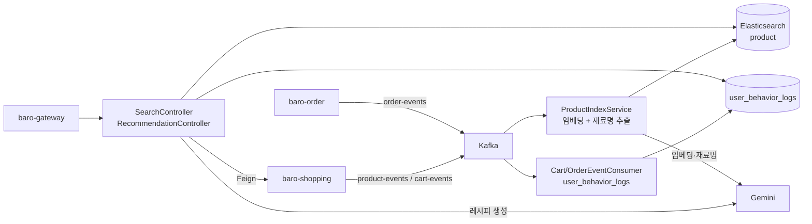

# 바로팜 AI 모듈 (baro-ai)

`baro-ai`는 바로팜(농산물 직거래) 백엔드의 AI 모듈이다. 사용자의 장바구니·주문 기록으로 상품을 추천하고, 장바구니 재료로 레시피를 제안하고, 상품 검색·자동완성을 제공한다. 이 문서는 모듈의 입구다 — 무엇을 하는지, 코드가 어떻게 놓여 있는지, 어떻게 띄우는지, 어느 문서를 더 읽을지를 한 장에 담는다.

## 언제 이 문서를 보는가

- 이 모듈을 처음 보는 사람이 전체 그림을 잡을 때
- 로컬에서 띄우거나 테스트를 돌려야 할 때
- 어떤 문서가 어디에 있는지 찾을 때 — 아래 "문서 맵"

## 무엇을 하나 — 작업 단위 4개

2026-09-04부터 감사·스펙·설명의 기본 단위는 코드 패키지가 아니라 아래 4개다. 단위 ↔ 클래스 매핑의 SSOT는 [`specs/README.md`](specs/README.md)다.

| 작업 단위 | 한 줄 | API | 스펙 | 설명 문서 |
|-----------|-------|-----|------|-----------|
| 취향 벡터 | 장바구니·주문 로그 → 행동 비중 → 상품 벡터 가중 평균 → 개인화 추천 | `GET /api/v1/recommendations/personalized/{userId}` | [`taste-vector-pipeline.md`](specs/taste-vector/taste-vector-pipeline.md) | [`features/taste-vector.md`](features/taste-vector.md) |
| 장바구니 레시피 | 장바구니 → 보유 재료 → LLM 레시피 1개 → 서버가 부족 재료 계산 → 상품 카드 | `GET /api/v1/recommendations/recipes/{userId}` | [`recipe-recommendation.md`](specs/cart-recipe/recipe-recommendation.md) | [`features/cart-recipe.md`](features/cart-recipe.md) |
| 임베딩 유사도 검색 | 상품 벡터 → 코사인 유사도 후보 → 카테고리 상한으로 고르기 → 유사 상품 | `GET /api/v1/recommendations/similar/{productId}` | [`vector-similarity-search.md`](specs/vector-similarity/vector-similarity-search.md) | [`features/vector-similarity.md`](features/vector-similarity.md) |
| 키워드 검색 | 상품 이벤트 색인 → 형태소·오탈자 검색 → 자동완성 | `GET /api/v1/search`, `/search/autocomplete`, `POST /search/admin/reindex` | [`product-search-and-autocomplete.md`](specs/keyword-search/product-search-and-autocomplete.md) | [`features/keyword-search.md`](features/keyword-search.md) |

그 밖에 둘이 있다. **리뷰 감정 분석·요약**(`review` 패키지)은 팀원 소유 도메인이라 이 문서 묶음의 범위 밖이고, 로드맵은 [`REVIEW_ANALYSIS_PHASES.md`](REVIEW_ANALYSIS_PHASES.md)에 있다. **챗봇**은 코드가 없다 — 목적이 정해지면 [`specs/chat/chatbot.md`](specs/chat/chatbot.md)에서 시작한다.

## 아키텍처

RDB가 없다. 검색·추천·로그 전부 Elasticsearch 문서다. 상품 정보는 Kafka `product-events`로, 사용자 행동은 `cart-events`·`order-events`로 들어오고, `baro-shopping`을 Feign으로 직접 부르는 곳은 둘이다 — 레시피 추천의 장바구니 조회(`CartClient`)와 재색인의 상품 목록 조회(`ProductCatalogClient`). LLM(Gemini)은 이 문서가 다루는 범위에서 색인 시점의 재료명 추출과 레시피 생성 두 곳에 쓴다(팀원 소유인 `review`의 리뷰 요약이 세 번째 호출부다).



### 패키지 구조

기능 패키지마다 `presentation → application → domain`, 그리고 외부 기술은 `infrastructure`에 둔다. 의존 방향은 안쪽(`domain`)으로만 흐른다.

```text
src/main/java/com/barofarm/ai/
├── search/          키워드 검색·색인·자동완성·재색인 (presentation · application · domain · infrastructure · exception)
├── recommend/       개인화·유사 상품·레시피 추천 (presentation · application · domain · infrastructure · exception)
├── embedding/       상품 임베딩, 취향 벡터 계산 (application · domain)
├── log/             행동 로그 문서·저장 (application · domain · infrastructure)
├── event/           Kafka 컨슈머와 이벤트 모델 (consumer · model)
├── config/          Kafka·LLM·캐시 설정 (Feign 값은 application.yml)
├── common/          LLM 호출 관문(LlmGateway)·전역 예외 처리·Swagger
└── review/          리뷰 감정 분석·요약 — 팀원 소유, 이 문서 범위 밖
```

## 기술 스택

| 영역 | 무엇 |
|------|------|
| 언어·프레임워크 | Java 21 · Spring Boot 3.5 · Gradle 8.14 |
| LLM | Google Gemini — 텍스트 `gemini-3.5-flash-lite`, 임베딩 `gemini-embedding-001`(768차원). Spring AI 1.1.8 `spring-ai-starter-model-google-genai` |
| 저장·검색 | Elasticsearch 8.x — Spring Data Elasticsearch, `dense_vector` + `script_score` |
| 메시징 | Apache Kafka — Spring Kafka, 실패 메시지는 `{토픽}.DLT` |
| 모듈 간 호출 | Spring Cloud OpenFeign(`baro-shopping` 장바구니) |
| 캐시 | Caffeine — 자동완성만. 근거: [`decisions/001`](decisions/001-autocomplete-caching.md) |
| 관측 | Spring Boot Actuator · Micrometer |

## 개발 시작하기

필요한 것: Java 21, Docker. 인프라(Elasticsearch·Kafka·MySQL)는 저장소 루트의 `docker-compose.data.yml`로 띄운다.

```bash
docker compose -f docker-compose.data.yml up -d
```

설정 파일은 `application.yml` 하나이고 환경 차이는 전부 환경변수다.

| 환경변수 | 뜻 | 기본값 |
|----------|-----|--------|
| `BARO_AI_GEMINI_KEY` | Gemini API 키 (필수) | 없음 |
| `ELASTICSEARCH_URIS` | Elasticsearch 주소 | `http://elasticsearch:9200` |
| `KAFKA_BOOTSTRAP_SERVERS` | Kafka 주소 | `localhost:29092` |
| `SHOPPING_SERVICE_URL` | 장바구니를 읽어 올 `baro-shopping` 주소 (레시피 추천용) | `http://baro-shopping:8080` (k8s 서비스 주소, 게이트웨이를 거치지 않음) |
| `SPRING_AI_GEMINI_MODEL` · `SPRING_AI_GEMINI_EMBEDDING_MODEL` | 모델 이름 덮어쓰기 | 위 표의 값 |
| `BARO_AI_ADMIN_TOKEN` | 전체 재색인 API의 `X-Admin-Token` | 없음(미설정이면 재색인 API 사용 불가) |
| `SERVER_PORT` | 포트 | `8092` |

```bash
export BARO_AI_GEMINI_KEY="..." ELASTICSEARCH_URIS="http://localhost:9200" KAFKA_BOOTSTRAP_SERVERS="localhost:9092"
./gradlew :baro-ai:bootRun
curl http://localhost:8092/actuator/health
```

**테스트는 로컬에서 돌린다.** `./gradlew :baro-ai:test`(2026-09-09 기준 17클래스 93건 — 순수 단위 테스트와 Testcontainers로 Elasticsearch를 띄우는 통합 테스트 1클래스). 배포 워크플로 `.github/workflows/baro-ai-deploy.yml`은 `bootJar` → ECR push → `k8s/apps/baro-ai/deployment.yml` 태그 커밋(ArgoCD가 따라감)만 하고 **테스트를 실행하지 않는다.** 테스트 기준은 [`.claude/rules/testing.md`](../../.claude/rules/testing.md), 프롬프트 품질은 [`scripts/goldenset/`](../scripts/goldenset/README.md)이 담당한다.

## 문서 맵

`baro-ai/docs/`는 이 모듈의 모든 마크다운 문서가 모이는 곳이다. 어떤 문서를 어디에 어떤 형식으로 쓰는지는 [산출물 등록부](templates/README.md)가, 문장·구조 기준은 [`.claude/rules/doc-writing.md`](../../.claude/rules/doc-writing.md)가 SSOT다.

| 경로 | 무엇이 있나 |
|------|-------------|
| [`features/`](features/README.md) | 작업 단위 4개의 목표·흐름·설계 결정·실측·한계 — 처음 보는 사람이 스펙 전에 읽는 문서 |
| [`specs/`](specs/README.md) | 기능 스펙(현재 동작·API·규칙의 SSOT). `Draft → Approved → Implemented` |
| [`decisions/`](decisions/README.md) | 되돌리기 비싼 선택의 근거와 트레이드오프(ADR) |
| [`audits/`](audits/README.md) | 아키텍처 감사·측정 보고서·리팩터 반영 이력·미결 항목·하네스 회고 |
| [`portfolio/`](portfolio/README.md) | 같은 4개 주제의 케이스 스터디 — 코드 변경이 끝난 뒤 재작성 예정 |
| [`product/`](product/README.md) | MVP 범위·용어 사전·클라이언트 전제 |
| [`harness/`](harness/README.md) | AI 에이전트 하네스의 레이어별 동작 |
| [`templates/`](templates/README.md) | 산출물 등록부 + 유형별 템플릿 4종 |

단일 문서: [Elasticsearch 인덱스 매핑](ELASTICSEARCH_SEARCH_EMBEDDING_ARCHITECTURE.md)(매핑 SSOT) · [취향 벡터 계산 예시](EMBEDDING_EXAMPLE.md) · [하네스 설계 배경](harness-engineering.md) · [리뷰 분석 로드맵](REVIEW_ANALYSIS_PHASES.md)(팀원 소유).

`FEATURES.md`·`IMPLEMENTATION.md`는 2026-09-09에 지웠다 — 스펙·`features/`와 같은 내용을 옛 구조로 다시 적은 문서였고, 코드를 복사해 둔 발췌가 매 라운드 stale해졌다([`audits/harness-retro.md`](audits/harness-retro.md)). API 예시·실행 절차는 각 스펙과 이 문서로 옮겼다.

## 기여

브랜치·커밋·PR 규칙의 SSOT는 [`.claude/rules/core-workflow-git.md`](../../.claude/rules/core-workflow-git.md)다 — `feature/issue-{번호}-{설명}` 브랜치, `[Type] #번호 - 한글 설명` 커밋, `main`에 merge commit. PR 전에 확인할 것은 셋이다: 계층 의존 방향이 안쪽으로만 흐르는가, `./gradlew :baro-ai:test`가 로컬에서 통과하는가, 스펙·문서를 같은 변경에서 고쳤는가.
