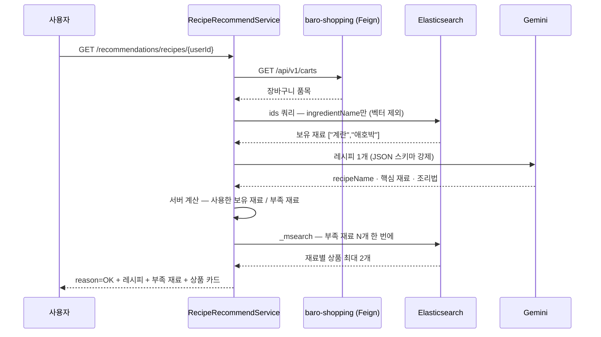

# 장바구니 레시피 — 보유 재료로 레시피를 만들고 부족한 재료를 상품으로 잇기

사용자의 장바구니를 요리 재료 목록으로 바꾸고, LLM(Large Language Model, 거대 언어 모델)에게 그 재료로 만들 수 있는 요리 1개를 받아, 그 요리에 필요하지만 장바구니에 없는 재료를 실제 판매 상품으로 연결하는 기능이다. 이 문서를 읽으면 LLM을 어디까지 믿고 어디서부터 서버가 계산하는지, 프롬프트를 "감"이 아니라 골든셋으로 고친다는 게 무슨 뜻인지, 그리고 이 기능의 품질이 프롬프트가 아니라 카탈로그에 막혀 있다는 결론이 어떻게 나왔는지를 알게 된다. 값은 [스펙](../specs/cart-recipe/recipe-recommendation.md)이 SSOT다.

## 목표와 하지 않는 것

**목표**

- 장바구니에 담긴 것으로 실제로 사람들이 만드는 요리를 1개 추천한다
- "이걸 더 사면 된다"가 반드시 1개 이상 있고, 그 재료를 지금 살 수 있는 상품으로 보여 준다
- LLM이 지어낸 값이 구매 유도 카드가 되지 않게 서버가 검증한다
- 장바구니가 비었거나 외부 서비스가 죽어도 화면이 깨지지 않는다 — 200 + 이유 코드

**하지 않는 것**

- 레시피 여러 개 비교·채점 — 2026-09-06에 후보 3개·채점식을 버렸다(아래 결정 2)
- 요청 시점에 상품명에서 재료명 뽑기 — 색인 시점에 한 번 한다(아래 결정 1)
- 카탈로그에 없는 재료를 "살 수 있는 것처럼" 보이기 — 없으면 카드가 빠지고 부족 재료 목록에는 남는다

## 한눈에 보는 흐름

| 단계 | 어디서 | 요약 |
|---|---|---|
| 장바구니 | `CartClient` (Feign, `ResponseDto<CartInfo>`) | 연결 1초·읽기 3초 상한. 제외 카테고리 목록은 2026-09-07부터 비어 있어 담긴 상품이 전부 재료 후보다 |
| 보유 재료 | `loadOwnedIngredientNames` | 상품 문서의 `ingredientName`(색인 시 LLM이 뽑아 둔 값)을 한 번에 읽는다 |
| 레시피 | `RecipeCandidateGenerator` | Gemini, JSON 스키마 강제, 후보 1개, temperature 0.7 |
| 서버 계산 | `CandidateRecipePlan.from` | 핵심 재료 ∩ 보유 = 사용한 재료, 핵심 − 보유 = 부족 재료 (공백·대소문자 무시) |
| 상품 연결 | `ProductSearchService.searchByKeywords` | 부족 재료 전부를 `_msearch` 1회로, 재료당 2개 |
| 재료명(색인 시) | `ProductIngredientNormalizer` | 상품명+카테고리 → 재료명, temperature 0 |

## 어떻게 동작하는가

아래에 나오는 수치는 [스펙 비즈니스 규칙 표](../specs/cart-recipe/recipe-recommendation.md#비즈니스-규칙)의 값을 옮긴 것이다 — 값이 바뀌면 스펙이 먼저다.

**재료명은 상품의 속성이지 요청의 속성이 아니다.** "곰곰 대란 30구"가 "계란"이라는 사실은 누가 언제 장바구니에 담든 같다. 그래서 상품이 색인될 때 한 번 LLM으로 뽑아 문서에 저장하고, 레시피 요청은 그 값을 읽기만 한다. 요청 경로에 남은 LLM 호출은 레시피 생성 1회뿐이다.

**LLM에게는 요리 이름·핵심 재료·조리법만 묻는다.** "사용한 재료"와 "부족한 재료"는 묻지 않는다 — 그 값이 곧 "이걸 사세요" 카드가 되는데 LLM은 그런 대조를 자주 틀린다. 서버가 보유 재료와 핵심 재료를 정규화 비교해 계산한다. 응답 형식은 프롬프트로 부탁하지 않고 Gemini API의 JSON 스키마 강제로 못 박는다.

**프롬프트는 후보 1개를 요구하고, 판매 유도는 "부족 재료 최소 1개"로 건다.** 보유 재료만으로 완성되는 요리라면 재료를 끼워 넣지 말고 요리 선택 자체를 바꾸라고 지시한다. 기본 양념(소금·간장 등)은 있다고 가정한다.

**실패는 예외가 아니라 이유 코드다.** 장바구니 비었음 / 쓸 수 있는 상품 없음 / 재료명 미색인 / LLM 실패 / 외부 연동 실패는 전부 200이고 `reason`이 다르다. 빈 장바구니는 오류가 아니라 사용자 상태라서다.

## 핵심 설계 결정

### 1. 재료명 추출을 요청 시점에서 색인 시점으로 옮겼다

- **문제**: 요청 1회가 LLM을 직렬로 3번 불렀다 — 상품명 정규화, 재료 재검증, 레시피 생성. 1번이 실패하면 상품별 개별 호출로 폴백해 최악 N+3회. 타임아웃도 없었다.
- **대안**: (a) 요청 결과를 캐시 (b) 상품 문서에 재료명 필드를 두고 색인 때 계산 (c) 정규식으로 대체.
- **선택**: (b). 폴백은 두지 않는다.
- **근거**: 앞의 두 호출은 입력이 상품명·카테고리뿐이라 사용자·시점에 의존하지 않는다 — 요청 단위 계산이 아니라 상품 단위 속성이다. 색인은 상품 CRUD 때만 일어나고 요청 경로 밖(Kafka 컨슈머)이다. (a)는 TTL·무효화 장치가 필요한데 (b)는 상품이 바뀌면 이벤트가 어차피 온다. (c)는 "대란"처럼 틀린 값을 정상 값처럼 저장한다 — 빈 값을 "모른다"는 신호로 남기는 편이 낫다. [`decisions/002`](../decisions/002-ingredient-name-at-index-time.md).
- **대가**: 프롬프트를 고치면 전량 재색인이 필요하다(이번 주에 두 번 고쳤다). 색인 시간에 LLM 호출이 들어간다.

### 2. 후보 3개 + 가중치 채점식을 버리고 후보 1개로

- **문제**: 프롬프트가 "서로 다른 조리 방식으로 3개"를 요구해, 마땅한 요리가 하나뿐인 장바구니에서도 세 번째 칸을 채우려고 "오이 파스타"를 지어냈다. 서버는 첫 후보만 썼다 — 이상한 답을 만들 압력만 주고 결과는 버렸다. 판매 유도도 "부족 재료 30~50%"라는 비율이라 억지로 재료를 끼워 넣었다.
- **대안**: (a) 채점식을 고쳐 억지 요리를 걸러낸다 (b) 후보를 1개로 줄이고 규칙을 문장으로 바꾼다.
- **선택**: (b). LLM 출력 필드도 8개 → 3개(후보 비교용 필드는 응답에 나가지도 않았다).
- **근거**: 골든셋 15종 중 LLM을 부르는 14종 × 3회 × 2팔 = 84건으로 측정 — 실행 단위 합격 **69.0% → 90.5%**, 출력 토큰 **−72.6%**, 재현 시나리오 "오이 파스타" 1/3 → 2/3. 1차 측정에서 "쌀·보리"가 부족 재료 0개로 회귀해 규칙 3을 고치고 다시 쟀다. [`audits/cart-recipe/002`](../audits/cart-recipe/002-goldenset-before-after.md).
- **대가**: 채점식 삭제 자체의 전후 비교 자료는 없다(삭제 전에도 점수를 로그로 남기지 않았다). 채점은 사람이 했다 — LLM 채점의 자기 편향을 피하려고.

### 3. 프롬프트를 "위험해 보여서" 고치지 않는다 — 가설 2건을 측정으로 기각했다

- **가설 A**: "기본 양념 목록을 넓히면 살 수 있는 재료가 는다." → 목표 지표 50%→45%(42건 중 2건, 잡음). 목록을 늘려도 모델이 20건이나 어긴다. **기각.**
- **가설 B**: "대파·쪽파·실파 변종이 헷갈리게 한다." → 합쳐도 나아지지 않았고 "이미 가진 걸 사라"는 141건에서 0건. **기각.**
- **결론**: 병목은 프롬프트가 아니라 카탈로그다 — "살 게 없는 추천" 50%는 김치·두부·장류만 팔면 10%로 떨어진다(분류기로 코드 고정). 판매 여부는 사업 결정이라 사용자가 정했다(김치·두부·장류 추가). [`audits/cart-recipe/003`](../audits/cart-recipe/003-pantry-staples-and-variants.md).

### 4. 실패 이유를 응답에 담고, 부족 재료 검색은 한 번에

- **문제**: 다섯 가지 상황이 전부 같은 빈 응답이라 화면이 "재료를 담아 보세요"와 "잠시 후 다시 시도"를 나눌 수 없었고, 최상위 catch가 예외 객체를 버려 장애 원인이 남지 않았다. 부족 재료 N개마다 ES를 순차로 N번 불렀다.
- **선택**: `reason` 6종 추가(계약 변경 — 사용자 승인), 예외 객체 로깅, `_msearch` 1회.
- **대가**: `_msearch`는 묶음 안 쿼리 하나가 실패하면 결과가 짧아져 순서가 밀린다(리뷰어 지적). 길이가 다르면 전부 빈 목록으로 맞춘다 — 카드를 엉뚱한 재료에 붙이는 것보다 낫다. [`audits/cart-recipe/005`](../audits/cart-recipe/005-request-path-defects-and-tests.md).

## 실측 근거

| 무엇 | 결과 | 원본 |
|---|---|---|
| 프롬프트 재설계 Before/After (84건) | 합격 69.0% → 90.5%, 출력 토큰 −72.6% | [`audits/cart-recipe/002`](../audits/cart-recipe/002-goldenset-before-after.md) |
| 양념 확대 가설 | 50% → 45% (기각) | [`003`](../audits/cart-recipe/003-pantry-staples-and-variants.md) |
| 카탈로그에 김치·두부·장류 추가 시 | 살 게 없는 추천 21/42 → 4/42 | [`003`](../audits/cart-recipe/003-pantry-staples-and-variants.md) 분류기 |
| 재료명 추출 (17개 상품명) | 16/17 → 17/17. 1차 개선안은 "포기김치→포기김치" 회귀를 숨기고 있었다 — 판정 기준을 조이자 드러남 | [`004`](../audits/cart-recipe/004-index-time-ingredient-name.md) |
| 요청 경로 LLM 호출 | 3회(최악 N+3) → 1회 | [`decisions/002`](../decisions/002-ingredient-name-at-index-time.md) |

측정 도구는 앱·ES·Kafka 없이 Gemini만으로 돈다([`scripts/goldenset/`](../../scripts/goldenset/README.md)). 합격 기준 5축(실재성·재료 정합성·보유 활용·조리법 타당성·판매 연결)은 재기 전에 스펙에 적었다.

## 운영·장애 관점

| 상황 | 동작 |
|---|---|
| 장바구니 서비스 장애 | `reason=UPSTREAM_ERROR`, 200. 스택트레이스 WARN |
| 장바구니 비었음·쓸 수 있는 상품 없음 | `EMPTY_CART`·`NO_ELIGIBLE_ITEMS` |
| 상품 문서에 재료명 없음 | `INGREDIENTS_NOT_INDEXED` + "재색인 필요" WARN |
| LLM 실패·파싱 실패 | `GENERATION_FAILED`, 보유 재료는 채워 돌려줌. Gemini 호출당 30초·총 3회 |
| 상품 검색 실패 | 레시피 본문은 살리고 카드만 비움(`OK`) |
| 한도 | Gemini 무료 티어 — 레시피 1회당 LLM 1회. 골든셋 측정도 같은 한도를 쓴다 |

## 알려진 한계·다음 단계

- **결정된 카탈로그 확장이 아직 실행되지 않았다.** 카테고리 4행은 저장소 루트 SQL(하네스 쓰기 범위 밖)이고 상품 시드도 필요하다. 그전까지 부족 재료 카드는 대부분 비어 있다.
- ~~**부족 재료를 상품에 연결할 때 색인해 둔 재료명을 쓰지 않는다.**~~ **2026-09-07 해소** — 부족 재료 전용 조회에 색인된 재료명 정확 일치를 가장 높은 가중치로 넣었다. 그 전에는 검색이 `productName`만 봐서 상품명이 재료를 다른 말로 부르면(`한우 등심` ↔ `소고기`) 카탈로그에 있어도 못 찾았다. 근거: [`audits/cart-recipe/006`](../audits/cart-recipe/006-missing-ingredient-product-match.md) A-1.
- **게이트웨이 prod 라우트에 인증 필터가 없어** `X-User-Id`를 위조하면 남의 장바구니 재료를 볼 수 있다. 게이트웨이 담당자 확인 대기.
- **게이트웨이 응답 상한(5초)과 LLM 최악 지연(30초×3회)이 맞지 않는다.** 정상 요청도 끊길 수 있다.
- **레시피 생성기 자체는 테스트가 없다.** `ChatClient` 체인을 mock하면 구현에 붙어서다 — 품질은 골든셋이 담당한다.
- **`baro-shopping` 실제 왕복은 아직 확인하지 못했다.** 2026-09-06 로컬 확인은 장바구니 API를 스텁으로 대체했다(그 모듈은 MySQL까지 필요하다). 계약대로 응답하면 레시피 전 경로가 도는 것은 확인했다 — 남은 것은 실제 모듈과의 필드·에러 계약이다.

## 관련 문서·코드

- 스펙: [`recipe-recommendation.md`](../specs/cart-recipe/recipe-recommendation.md) · [`recipe-quality-redesign.md`](../specs/cart-recipe/recipe-quality-redesign.md) · [`pantry-staples-and-catalog-coverage.md`](../specs/cart-recipe/pantry-staples-and-catalog-coverage.md)
- 결정: [`decisions/002`](../decisions/002-ingredient-name-at-index-time.md) · [`decisions/003`](../decisions/003-gemini-migration.md)
- 감사·측정: [`audits/cart-recipe/001`](../audits/cart-recipe/001-cart-integration-and-request-path.md)~[`005`](../audits/cart-recipe/005-request-path-defects-and-tests.md), [`audits/recommend/002`](../audits/recommend/002-recipe-scoring.md)(채점식)
- 반영 이력: [`audits/cart-recipe/refactor-log.md`](../audits/cart-recipe/refactor-log.md)
- 코드: `recommend.application.RecipeRecommendService`, `recommend.domain.CandidateRecipePlan`·`IngredientProcessingUtil`, `recommend.infrastructure.llm.RecipeCandidateGenerator`, `recommend.infrastructure.client.CartClient`, `search.infrastructure.llm.ProductIngredientNormalizer`
- 측정 도구: [`scripts/goldenset/`](../../scripts/goldenset/README.md)
