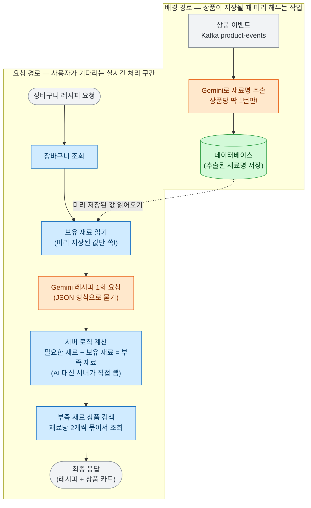

# 장바구니 레시피 (Cart Recipe)

## 개요
장바구니에 담긴 상품들의 '재료명'을 파악해서, AI(Gemini)가 어울리는 요리 레시피를 딱 1개 제안해 주는 기능이에요. 이때 장바구니에 이미 있는 재료와 요리에 필요한 전체 재료를 비교해서, **"우리 가게에서 추가로 사면 좋은 부족한 재료"**를 상품 카드 형태로 함께 보여줘요.

## 목표와 하지 않는 것

**목표**
- 실시간으로 사용자가 화면을 볼 때, AI 응답 때문에 기다리는 시간을 최소화해요.
- AI가 거짓말(할루시네이션)을 하거나 엉뚱한 요리를 내놓지 않도록 꼼꼼하게 통제해요.
- 만약 AI 응답이 실패하거나 에러가 나더라도, 장바구니 화면 전체가 고장 나지 않도록 부드럽게 대처해요.

**하지 않는 것 (의도적으로 뺀 것)**
- 레시피 여러 개를 비교하고 점수를 매기는 일 (예전에는 3개를 비교했지만, 퀄리티를 높이기 위해 가장 자신 있는 1개만 제안하도록 개선했어요.)
- 레시피를 요청할 때마다 상품명에서 재료명을 뽑아내는 일 (매번 하면 느려지므로, 상품이 등록될 때 미리 한 번만 작업해 둬요.)
- 우리가 팔지 않는 재료를 억지로 사라고 유도하는 일 (우리 가게에 없는 재료라면 상품 검색을 멈추고, '부족한 재료' 이름만 목록에 조용히 남겨둬요.)

## 한눈에 보는 흐름

요청이 들어왔을 때 어떤 순서로 처리되는지 보여주는 그림이에요. 실시간 요청이 들어오기 전 '미리 준비해 두는 작업'과 '실시간 작업'으로 나뉘어 있어요.

- **주황색:** 외부 AI(Gemini)에게 일을 시키는 구간
- **파란색:** 우리 서버가 빠르고 정확하게 직접 계산하는 구간
- **초록색:** 데이터베이스(Elasticsearch) 구간

점선은 실시간 요청 전에 미리 저장된 값을 읽어온다는 뜻이에요. **재료 이름은 실시간으로 AI에게 묻지 않고 미리 저장해 둔 값을 사용**해요. 그래서 사용자가 기다리는 동안에는 AI를 딱 1번만 부르면 되죠. 

## 어떻게 동작하나요?

(세부적인 규칙이나 숫자는 스펙 문서를 우선으로 따라요.)

- **재료명은 미리 뽑아둬요.** 
  "곰곰 대란 30구"가 "계란"이라는 건 변하지 않죠. 그래서 상품 정보를 저장할 때 AI가 미리 "계란"이라는 이름을 뽑아 저장해 둬요. 나중에 사용자가 레시피를 요청하면 이 값을 그냥 읽기만 하면 돼서 무척 빨라요.
- **AI에게는 딱 필요한 것만 묻어요.**
  AI에게는 요리 이름, 필요한 핵심 재료, 그리고 조리법만 물어봐요. "사용자가 가지고 있는 재료"와 "부족한 재료"를 비교하는 수학적인 일은 AI가 자주 틀리기 때문에, **서버가 직접 빼기 계산**을 해요.
- **억지로 구매를 유도하지 않게 지시해요.**
  AI에게 "레시피 후보는 딱 1개만", 그리고 "부족한 재료가 생기는 요리를 제안하라"고 미리 일러둬요. 장바구니에 있는 재료만으로 요리가 끝난다면 억지로 끼워 팔지 않게 하는 거죠. 그리고 우리가 파는 범위를 **기준 한 줄**로 알려줘요 — "농산물·축산물 6종 밖은 팔지 않으니 핵심 재료에 넣지 마라." 처음엔 "소금·설탕 같은 양념은 빼라"고 **품목을 하나씩 나열**해 봤는데, 목록을 7개에서 15개로 늘려도 모델이 지키지 않아서(설탕은 예시로 직접 적었는데도 핵심 재료에 넣었어요) 그 방식은 버렸어요. **모델은 낱개 목록은 안 지키지만 기준 한 줄은 지킵니다.**
- **에러가 나도 화면은 정상 작동해요.**
  장바구니가 비었거나, 추천할 요리가 없거나, AI가 뻗어도 시스템이 멈추지(500 에러) 않아요. 일단 정상(200) 응답을 주되, 내부에 `reason`(이유 코드)을 담아 보내서 화면에 "재료를 더 담아보세요" 같은 안내 문구가 부드럽게 뜰 수 있게 해요.

## 핵심 설계 결정

### 1. 재료명 추출 타이밍을 "실시간"에서 "저장할 때"로 바꿨어요.
- **문제점:** 원래는 사용자가 레시피를 누를 때마다 AI를 3번씩이나 불렀어요. 한 번이라도 통신이 지연되면 화면이 멈춰있었죠.
- **해결책:** "대란 = 계란" 같은 정보는 바뀌지 않으므로, 상품을 데이터베이스에 넣을 때 한 번만 계산해서 꼬리표를 달아두기로 했어요.
- **효과:** 요청 속도가 비약적으로 빨라졌고 실시간 AI 호출도 1번으로 줄었어요.

### 2. 레시피 후보 3개를 버리고 '가장 확실한 1개'만 받아요.
- **문제점:** 예전에는 무조건 요리를 3개씩 만들라고 AI를 닦달했어요. 그러다 보니 적당한 요리가 1개뿐인데도 분량을 채우려고 이상한 퓨전 요리를 지어내곤 했어요. 
- **해결책:** 억지로 채점하는 방식을 버리고, AI에게 "가장 어울리는 요리 딱 1개만 내놓아라"라고 지시했어요.
- **효과:** 84개의 정답지(골든셋)로 테스트해 보니, 요리의 질(합격률)이 **69%에서 90.5%로 훌쩍 올랐고**, 쓸데없는 말을 안 하니 비용(토큰)도 72%나 줄었어요. 

### 3. 막연한 추측을 멈추고 데이터를 분석했어요.
- **문제점:** 추천이 이상할 때 "AI 프롬프트(질문)가 별론가?"라고 막연히 의심하며 양념 목록을 늘려보거나 단어를 통일해 보려는 헛고생을 했어요.
- **해결책:** 실제로 데이터를 측정해 보니 원인은 프롬프트가 아니라 **'우리 쇼핑몰에 팔지 않는 물건이 많아서'**였어요. 
- **결론:** 김치, 두부 같은 뼈대 식재료를 카탈로그에 더 추가해야 한다는 정확한 해결책을 찾을 수 있었어요.

### 4. 실패 이유 코드를 세분화하고 검색을 묶었어요.
- **문제점:** 에러가 나도 화면엔 늘 "장바구니에 담아보세요"라는 똑같은 문구만 떴어요. 부족한 재료를 검색할 땐 DB를 여러 번 들락날락했고요.
- **해결책:** 6종류의 명확한 에러 코드(`reason`)를 만들었고, 부족 재료 검색은 딱 한 번에 묶어서(`_msearch`) 처리하도록 다듬었어요.

### 5. 근거 없는 '과일 제외 규칙'을 삭제했어요.
- **문제점:** 장바구니에 과일이 들어있으면 레시피가 안 나오는 묘한 버그가 있었어요. 알고 보니 예전 프롬프트 시절 "과일이 들어가면 요리가 이상해진다"는 이유로 코드에 억지로 '과일 금지'를 걸어둔 탓이었어요.
- **해결책:** 금지 코드를 풀고 실제로 60번을 테스트해 보았어요. 지금의 발전된 프롬프트에서는 과일이 들어가도 레시피가 전혀 망가지지 않고 정상적으로 작동한다는 것을 데이터로 증명한 뒤, 금지 규칙을 과감히 지웠어요.

## 측정 결과 (성능 향상)

| 비교 항목 | 개선 결과 | 비고 |
|---|---|---|
| 프롬프트 개선 전/후 | 요리 합격률 **69.0% → 90.5%** 상승 | 84개 케이스 테스트 |
| AI 출력 토큰량 | **72.6% 감소** (비용 절감) | |
| 과일 허용 전/후 | 보유 재료 활용률 63.9% → **79.4%**로 상승 | 60회 테스트 |
| 실시간 LLM 호출 횟수 | 3회 (최악의 경우 무한 대기) → **딱 1회** | |

*(측정은 시스템 연동 없이 AI(Gemini) 호출만 분리하여 독립적인 테스트 도구를 만들어 진행했어요.)*

## 운영 및 장애 방어

- **장바구니 서비스가 죽는다면?** -> `UPSTREAM_ERROR` 코드를 내보내고, 화면이 멈추지 않게 방어해요.
- **AI가 고장 나거나 응답이 늦어지면?** -> 3초까지만 기다리고 가차 없이 끊어요(`GENERATION_FAILED`). 대신 이미 있는 재료는 화면에 그대로 띄워줘요.
- **사용자가 폭주하면?** -> 동시에 AI를 부르는 요청을 5개로 제한(격벽)하여, 서버가 통째로 다운되는 것을 막아요. 자리가 없으면 빈 결과를 줘요.

## 알려진 한계와 다음 단계

- **아직 안 파는 물건이 많아요.** 김치, 두부 등을 팔기로 결정은 했지만 아직 데이터베이스에 추가되진 않았어요. 그 전까지는 추천 상품이 빈칸으로 나오는 경우가 종종 있을 거예요.
- **응답 시간(타임아웃) 조율이 남았어요.** 각 단계별로 기다려주는 시간(장바구니 4초 + 검색 3초 + AI 3초 + 검색 3초)을 다 더하면 우리가 목표로 한 5초를 훌쩍 넘어요. 다행히 이렇게 꽉 채워 걸리는 일은 거의 없지만, 나중에 어느 쪽의 시간을 더 빡빡하게 줄일지 상의가 필요해요.
- **다른 팀 시스템과의 완벽한 통합 테스트.** 현재는 임시 서버(스텁)로 훌륭하게 돌아가는 것을 확인했지만, 실제 장바구니 DB와 연결했을 때 미묘한 데이터 에러가 날지는 마지막 통합 테스트 때 잡아내야 해요.

## 관련 문서 모음

- 스펙 문서: [recipe-recommendation.md](../specs/cart-recipe/recipe-recommendation.md) 
- 의사 결정(ADR): [AI 처리 시점 변경](../decisions/002-ingredient-name-at-index-time.md)
- 전체 성능 기록(감사): [audits/cart-recipe/](../audits/cart-recipe/001-cart-integration-and-request-path.md)
