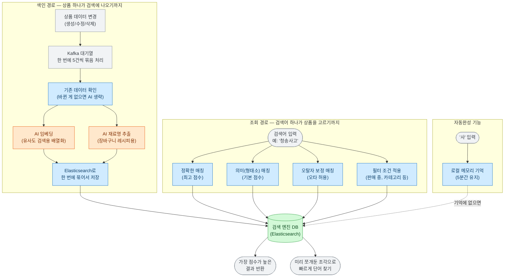

# 검색 (Keyword Search & Autocomplete)

이 기능은 상품이 새로 등록되거나 정보가 바뀔 때마다 자동으로 검색 엔진(Elasticsearch)에 정보를 채우고, 사용자가 편하게 키워드 검색과 자동완성을 사용할 수 있게 해주는 기능이에요. 

이 문서를 읽으시면 하나의 상품이 검색 결과에 나오기까지 어떤 과정을 거치는지, 검색어 하나가 어떤 똑똑한 방법으로 상품을 찾아내는지, 그리고 왜 이런 구조로 설계했는지 쉽게 이해하실 수 있어요. 

## 목표와 하지 않는 것

**목표 (우리가 하려는 것)**
- 상품 정보가 생기거나 바뀌면, 사람의 개입 없이 곧바로 검색 결과에 반영되게 해요.
- 한국어 상품명을 의미(형태소) 단위로 꼼꼼히 찾고, 한 글자 정도의 가벼운 오타는 알아서 잡아줘요.
- 사용자가 두 글자만 쳐도 관련 상품명이 바로 뜨는 빠릿빠릿한 '자동완성' 기능을 제공해요.
- 데이터 저장 과정이 늦어지거나 외부 AI(Gemini)에 장애가 생겨도, 사용자의 검색 자체는 절대 멈추지 않게 보호해요.

**하지 않는 것 (의도적으로 뺀 것)**
- 상품의 상세 설명이나 리뷰 본문 내용까지 검색하지 않아요. 오직 '상품명' 하나로만 승부해요.
- 가격순, 인기순 같은 정렬은 제공하지 않아요. 오직 '얼마나 검색어와 관련이 높은가(관련도)' 순서로만 보여줘요.
- 검색 결과 전체를 시스템 메모리(캐시)에 저장해두지 않아요. 캐시 기능은 '자동완성'에만 부분적으로 적용했어요.
- 전체 상품을 한 번에 싹 다 다시 저장하는(자동 재색인) 스케줄러는 없어요. 대규모 재작업이 필요할 땐 관리자가 수동으로 버튼(API)을 눌러요.

## 한눈에 보는 흐름

상품 정보가 시스템에 저장되는 '색인 경로'와, 사용자가 상품을 찾는 '조회 경로'를 나눠서 그린 그림이에요. 두 경로는 검색 엔진 데이터베이스를 공유할 뿐 서로 독립적으로 움직이에요.

- **저장과 검색은 별개예요:** 검색어 하나를 치면 시스템은 (1) 완벽히 똑같은지 (2) 단어 의미가 같은지 (3) 오타가 섞였는지를 **세 갈래로 동시에 검사**해서 점수를 합쳐요.
- **AI 장애에 강해요:** 주황색으로 칠해진 외부 AI 모듈은 '저장할 때'만 쓰이에요. 그래서 구글 Gemini 서비스가 다운되더라도, 새로운 상품의 일부 정보만 잠시 비워둘 뿐 검색 서비스 자체는 아무 문제 없이 쌩쌩하게 돌아가요.

## 어떻게 동작하나요?

- **데이터 저장(색인):** 새로운 상품이 들어오면 AI가 '비슷한 상품 찾기용' 숫자 배열(임베딩 벡터)을 만들고, '레시피 추천용' 재료명을 뽑아냅니다. 만약 상품 이름은 그대로고 가격만 바뀌었다면, 똑똑하게도 이 무거운 AI 과정을 건너뛰고 가격만 쏙 바꿉니다.
- **검색 로직:** 검색어 하나에 세 가지 돋보기를 동시에 댑니다. 
  1. 단어가 완벽히 똑같은지 검사 (가장 높은 점수 부여)
  2. 형태소를 분석했을 때 단어가 일치하는지 검사 (기본 점수 부여)
  3. 한 글자 정도 오타가 있는지 검사 (낮은 점수 부여) 
  이 점수들을 합쳐서 가장 높은 상품부터 순서대로 보여줘요. 여기에 '판매 중인가?', '가격은 얼마인가?' 같은 필터 조건은 점수와 무관하게 덧입혀집니다. 응답 속도를 빠르게 하기 위해 용량이 아주 큰 '벡터' 데이터는 최종 결과에서 빼고 돌려줘요.
- **자동완성:** '사과'를 입력할 때를 대비해 '사', '사과', '사과주' 같은 **글자 단위 조각들**을 상품 등록 시점에 미리 다 잘라 저장해둬요. 사람들이 자주 찾는 글자는 서버에 5분 동안 기억(캐시)해두어서 정말 눈 깜짝할 새에 결과를 돌려줘요.

## 핵심 설계 결정

### 1. 오타 보정은 문장 전체가 아니라 '띄어쓰기' 단위로 검사해요.
- **문제점:** 원래는 "청송 꿀사과 부사 5kg"처럼 긴 이름 전체에 오타 검사를 걸었어요. 그랬더니 "사과"처럼 짧은 단어를 쳤을 때는 전체 글자 수와 너무 차이가 나서 오타 보정 기능이 아예 먹통이 되었어요.
- **해결책:** 띄어쓰기 단위로 단어를 잘게 쪼갠 필드를 따로 만들어서, 그 조각마다 오타 검사를 하도록 바꿨어요. 단어의 첫 글자만 맞으면 그 뒤의 한 글자 정도는 틀려도 찰떡같이 잡아내요.
- **효과:** "삼결살"을 쳐도 "삼겹살"이 예쁘게 검색돼요. 단, 이 규칙 때문에 단어를 합쳐서 치는 경우("사가" -> "꿀사과")는 잡아내지 못하지만 충분히 감수할 만한 결과이에요.

### 2. 자동완성을 위한 확장은 '저장할 때' 한 번만 해요.
- **문제점:** 예전에는 글자를 쪼개서 저장해놓고, 검색할 때도 또 한 번 글자를 쪼개고 확장했어요. 이렇게 양쪽에서 확장을 하니 단어를 두 개 이상 쳤을 때 결과가 증발해 버리는 에러가 났어요.
- **해결책:** 검색할 때는 복잡하게 확장하지 않고, 사용자가 친 글자 그대로 단순하게 검색하도록 바꿨어요. 어차피 쪼개진 글자는 저장될 때 다 만들어두었으니까요.

### 3. '검색 결과'는 빼고, 오직 '자동완성'만 기억(캐시)해요.
- **문제점:** 이전 코드에는 메모리에 기억해 두는 캐시 기능이 검색 결과 전체에 무한정으로 달려 있었어요.
- **해결책:** 로컬 캐시를 '자동완성' 기능에만 달았어요. (최대 1000개, 5분 유지)
- **이유:** 자동완성은 사람들이 "사", "사과"처럼 앞글자가 겹치는 검색어를 엄청 많이 반복해서 요청하므로 캐시 효율이 좋어요. 반면 진짜 검색은 조건과 조합이 수만 가지라 캐시의 효과가 거의 없고, 상품 상태가 바뀌었을 때 검색 결과에 바로 반영되어야 하기 때문이에요.

### 4. 상품 저장은 한 번에 5개씩 묶어서 처리해요.
- **문제점:** 예전에는 상품이 13개만 연달아 등록돼도 AI 무료 API 한계에 부딪혀 에러가 났어요.
- **해결책:** 카프카(Kafka) 대기열을 이용해 5개씩 묶어서 한 번에 처리(Batch)하도록 바꿨어요. 
- **효과 및 단점:** 속도가 빨라지고 API 에러가 줄었지만, 5개 중 1개만 에러가 났을 때 처리하는 로직이 꽤 복잡해졌어요. 지금은 에러가 난 위치를 정확히 파악해서, 그 앞까지는 성공 처리하고 에러 난 부분부터 다시 시도하는 안전한 로직을 적용했어요.

### 5. 검색 기록을 '취향 추천 점수'에서 완전히 뺐어요.
- **문제점:** 원래는 사용자가 검색할 때마다 이 사람의 '취향 점수'에 반영했어요. 그런데 실측을 해보니 검색 데이터의 무려 65%가 비동기 처리 과정에서 조용히 버려지고 있었어요.
- **진짜 문제:** 데이터를 다 살려낸다 해도 더 큰 문제가 있었어요. 사용자가 '청소기'를 검색했을 때 나오는 상위 상품들은 사용자의 취향이라기보다는 **'검색 엔진이 잘 나간다고 올린 상품'**일 뿐이에요. 클릭도 안 했는데 취향이라고 볼 수 없죠.
- **해결책:** 과감하게 검색 데이터를 개인화 추천(취향) 데이터에서 통째로 빼버렸어요.
- **효과:** 버려지던 에러 데이터가 0건으로 깔끔해졌고, 시스템 성능도 확연히 빨라졌어요. 신규 회원이 취향 점수를 쌓기 조금 어려워졌다는 단점은 있지만 감수할 만해요.

## 측정 결과 (데이터)

| 측정 내용 | 결과 |
|---|---|
| 상품 문서 통신 크기 | 벡터 용량을 포함하면 21KB → 벡터를 빼고 돌려주면 **약 371 Byte** (응답 속도 대폭 상승) |
| DB 저장 속도 | 1건씩 1000번 넣으면 4.95초 → **한 번에 묶어 넣으면 1.16초** (약 4.3배 빠름) |
| AI 임베딩 묶음 처리 | 1건씩 보내면 13건 만에 뻗음 → **10건씩 묶어 보내면 50건 모두 안정적으로 성공** |
| 재료명 추출 정확도 | 프롬프트 개선 및 김치/장류 예시 추가 후 **17개 중 17개 완벽 추출** (정답률 100%) |

## 운영 및 장애 대응 가이드

- **AI 임베딩이 뻗으면?** -> 실패한 상품은 벡터값을 비운 채 저장해요. 일반 키워드 검색에는 아무 영향이 없으며 임베딩 유사도 검색 후보에서만 빠집니다.
- **Kafka 메시지 형식이 깨졌다면?** -> 전체 시스템이 멈추지 않게끔, 해석이 불가능한 파손된 데이터는 에러 전용 보관함(`.DLT`)으로 조용히 빼둬요.
- **묶음 저장 중 하나가 실패하면?** -> 실패한 위치를 기억해두었다가 그 자리부터 다시 시도해요. 끝내 실패하면 역시 `.DLT` 보관함으로 옮깁니다.
- **페이지를 비정상적으로 넘긴다면?** -> 한 번에 10,000건 넘게 조회하려 하거나 페이지 번호가 꼬이면, 서버가 죽는 대신 깔끔하게 400(잘못된 요청) 에러를 냅니다.

## 알려진 한계와 다음 단계

- **재료명 추출 AI는 여전히 1개씩 묻어요:** 검색용 임베딩은 묶어서 통신하지만, 재료명을 뽑아내는 작업은 아직 상품 1개당 1번씩 따로따로 AI를 부릅니다. 이 부분을 묶음 처리로 바꾸면 더 빨라지겠지만, 품질(정답률 100%)을 그대로 유지할 수 있는지 다시 꼼꼼히 검증해야 해서 다음 단계로 미뤘어요.
- **수정 시간이 정확하지 않을 수 있어요:** 현재 기록되는 수정 시간(`updatedAt`)은 상품이 실제로 바뀐 시간이 아니라, 우리 시스템에 '전달된 시간'이에요. 근본적으로 상품 모듈 쪽에서 실제 변경 시간을 찍어서 줘야 해결할 수 있어요.
- **이벤트 순서가 섞일 아주 작은 확률:** 메시지에 고유 키가 없어서, 인터넷 지연으로 늦게 도착한 과거 정보가 방금 저장된 최신 정보를 덮어쓸 아주 희박한 확률이 존재해요.
- **재시도 로직의 수동 검증:** 자동화된 통합 테스트는 **검색 엔진(Elasticsearch) 한 종류뿐**이에요(`Testcontainers`로 실제 ES를 띄워 저장 형식과 자동완성 접두어 매칭을 확인). **카프카나 AI를 띄우는 통합 테스트는 아직 없어서**, 묶음 저장 중간에 에러가 났을 때 그 자리부터 다시 시도하는지는 수동으로만 확인했어요. 이 부분이 이 기능에 남은 가장 큰 검증 구멍이에요.

## 연관된 문서 및 코드 모음

- 스펙 문서: [`specs/keyword-search/product-search-and-autocomplete.md`](../specs/keyword-search/product-search-and-autocomplete.md)
- 결정 기록: [자동완성 캐시 도입 결정](../decisions/001-autocomplete-caching.md)
- 전체 성능 기록(감사): [`audits/keyword-search/001`](../audits/keyword-search/001-query-path.md)
