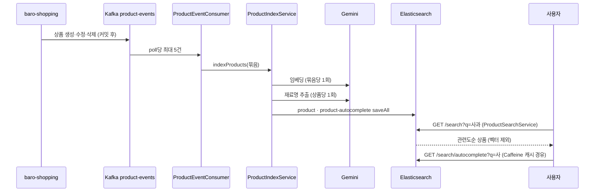

# 검색 — 상품 색인·키워드 검색·자동완성

상품 모듈(`baro-shopping`)이 상품을 만들거나 고칠 때 보내는 Kafka 이벤트로 Elasticsearch 상품 인덱스를 채우고, 그 인덱스 위에서 키워드 검색과 자동완성을 제공하는 기능이다. 이 문서를 읽으면 상품 하나가 검색에 나오기까지 무슨 일이 일어나는지, 검색어 하나가 어떤 순서로 상품을 고르는지, 그리고 왜 그렇게 설계했는지를 알게 된다. 값·계약은 [스펙](../specs/keyword-search/product-search-and-autocomplete.md)이 SSOT다.

## 목표와 하지 않는 것

**목표**

- 상품이 생기거나 바뀌면 사람 개입 없이 검색에 반영된다
- 한국어 상품명을 형태소 단위로 찾고, 한 글자 오타는 잡아 준다
- 두 글자만 쳐도 상품명 자동완성이 뜬다
- 색인이 느려지거나 외부 AI가 죽어도 검색 자체는 계속된다

**하지 않는 것**

- 상품 설명·리뷰 본문 검색 — 상품 문서에 `productName` 외 텍스트 필드가 없다
- 가격순·인기순 정렬 — 관련도순 고정([`product/mvp.md`](../product/mvp.md))
- 검색 결과 캐싱 — 자동완성만 로컬 캐시([`decisions/001`](../decisions/001-autocomplete-caching.md))
- 재색인 배치 — 아직 없다. 재색인은 상품 이벤트를 다시 발행하는 방식이다

## 한눈에 보는 흐름

| 단계 | 어디서 | 요약 |
|---|---|---|
| 발행 | `baro-shopping` `ProductEventPublisher` | 트랜잭션 커밋 후 발행. 키 없음(순서 미보장 — 리스크) |
| 소비 | `ProductEventConsumer` | 묶음 리스너. 생성·수정은 모으고, 삭제를 만나면 모인 것을 먼저 색인한 뒤 삭제 |
| 색인 | `ProductIndexService.indexProducts` | 임베딩(묶음 1회) → 재료명(상품별) → 두 인덱스 bulk 저장 |
| 검색 | `ProductSearchService.search` | 정확 구문·형태소·오탈자 3중 should + 상태·카테고리·가격 filter |
| 자동완성 | `ProductSearchService.autocomplete` | `edge_ngram` 인덱스 + Caffeine 캐시 |

## 어떻게 동작하는가

아래에 나오는 수치(가중치·길이·캐시 크기)는 [스펙 비즈니스 규칙 표](../specs/keyword-search/product-search-and-autocomplete.md#비즈니스-규칙)의 값을 옮긴 것이다 — 값이 바뀌면 스펙이 먼저다.

**색인.** 상품 이벤트가 오면 상품명을 두 가지로 가공해 저장한다. 하나는 벡터(임베딩 검색용, [임베딩 검색 문서](vector-similarity.md)), 다른 하나는 요리 재료명(장바구니 레시피용, [장바구니 레시피 문서](cart-recipe.md))이다. 둘 다 외부 AI 호출이라 실패할 수 있고, 실패해도 상품은 색인된다 — 벡터는 `null`, 재료명은 빈 문자열로 남고 "재색인 대상" 경고가 찍힌다. 검색은 상품명만 쓰므로 영향이 없다.

**검색.** 검색어 하나에 세 가지 매칭을 동시에 건다. 정확 매칭(`match_phrase`, 가중치 2.0), 일반 매칭(nori 형태소, 가중치 1.0), 오탈자 매칭(`fuzziness=1`, 가중치 0.3). 하나라도 맞으면 후보가 되고, 점수 합으로 정렬한 뒤 같은 점수면 최신 이벤트 순이다. 판매 중 상태·카테고리·가격 범위는 점수와 무관한 필터다. 응답에서 벡터는 받지 않는다 — 문서 하나가 벡터 포함 약 21KB, 제외하면 약 371바이트다.

**자동완성.** 색인 시점에 상품명을 1~20자 접두어 조각(`edge_ngram`)으로 저장해 두고, 조회는 입력한 말 그대로 `match`한다. 같은 접두어는 여러 사용자가 반복하므로 인스턴스별 Caffeine 캐시(1,000개·5분)를 앞에 둔다.

**부작용 없음.** 검색은 조회만 한다. 2026-09-07까지는 회원 검색마다 로그를 남기고 취향 벡터 갱신을 요청했으나, 검색이 취향 신호에서 빠지면서 그 경로를 통째로 지웠다([개인별 추천 문서](taste-vector.md)).

## 핵심 설계 결정

### 1. 오타 매칭은 상품명 전체가 아니라 띄어쓰기 단위 필드에 건다

- **문제**: 처음에는 `productName`(nori 형태소 필드) 전체에 `fuzziness`를 걸었다. 검색어 "사과"와 저장된 "청송 꿀사과 부사 5kg"는 길이 차이가 커서 한 글자 오타 허용으로는 아예 매칭이 안 됐다 — 오타 검색이 존재하지만 동작하지 않는 상태였다.
- **대안**: (a) `fuzziness=AUTO`로 허용 폭을 늘린다 (b) 띄어쓰기 단위 서브필드(`productName.word`)를 따로 두고 거기에 건다 (c) 오타 매칭을 뺀다.
- **선택**: (b). 단어마다 한 글자 오타를 잡되 첫 글자는 맞아야 한다(`prefixLength=1`).
- **근거**: (a)는 두 글자 검색어에서 엉뚱한 상품을 대량으로 끌어온다. (c)는 기능 자체를 포기하는 것이다. 감사 [`keyword-search/001`](../audits/keyword-search/001-query-path.md) A-1.
- **대가**: 인덱스에 서브필드 하나가 늘어 저장이 조금 커진다. 두 글자 미만 검색어는 오타 매칭을 아예 걸지 않는다. 그리고 **띄어쓰기로 분리된 단어에만 걸린다** — `삼결살`은 `삼겹살`을 찾지만 `사가`는 `꿀사과`를 못 찾는다(`꿀사과`가 한 토큰이라 편집거리가 2다). 2026-09-06 실측: [`audits/keyword-search/003`](../audits/keyword-search/003-local-integration-verification.md) C-1

### 2. 자동완성은 색인 쪽에서만 접두어를 만든다

- **문제**: 색인은 `edge_ngram`으로 접두어를 만들고, 조회는 `match_phrase_prefix`로 또 접두어 확장을 했다. 두 단어를 치면 결과가 사라지는 이중 확장 결함이 있었다.
- **대안**: (a) 조회 쪽 확장을 유지하고 색인 쪽 `edge_ngram`을 뺀다 (b) 조회를 `match`로 단순화한다.
- **선택**: (b). 접두어는 색인 쪽이 이미 갖고 있다.
- **근거**: (a)는 접두어 확장을 매 조회마다 다시 하므로 캐시 이득이 준다. 감사 [`keyword-search/001`](../audits/keyword-search/001-query-path.md) A-2.
- **대가**: 없음 — 결함 수정에 가깝다.

### 3. 자동완성만 캐시하고, 검색 결과는 캐시하지 않는다

- **문제**: `@Cacheable`이 붙어 있었지만 `@EnableCaching`이 없어 캐시가 **아무 일도 안 하는** 상태였다(grep으로 확인). 그리고 Spring 기본 캐시는 크기·만료가 없어 무한히 쌓인다.
- **대안**: (a) Redis 도입 (b) Caffeine 로컬 캐시 (c) 캐시 제거.
- **선택**: (b), 자동완성에만. 1,000개·5분.
- **근거**: 자동완성은 입력할 때마다 호출되고 접두어가 겹친다. 검색 결과는 파라미터 조합이 많아 적중률이 낮고, 상품 상태 변경이 5분간 늦게 보이는 걸 검색에서는 허용하기 어렵다. Redis는 baro-ai에 없고 이 트래픽에서 새 인프라를 정당화할 수 없다. [`decisions/001`](../decisions/001-autocomplete-caching.md).
- **대가**: 인스턴스별 캐시라 여러 인스턴스면 각자 따로 데운다. 상품이 품절돼도 자동완성에 최대 5분 남는다.

### 4. 색인은 상품 5개씩 묶고, 묶음 안에서 하나가 실패해도 나머지를 잃지 않는다

- **문제**: 상품 1건마다 임베딩 API 1회·재료명 LLM 1회를 순차로 부르고, Kafka는 poll당 1건만 가져왔다. 재색인이 상품 수 × 3초였고, 무료 티어에서는 임베딩을 1건씩 보내면 **13회 뒤 429**가 나서 끝까지 가지도 못했다.
- **대안**: (a) 그대로 두고 재색인은 밤에 (b) poll당 N건 묶음 + 임베딩 배치 (c) 앱 안에 색인 스레드풀.
- **선택**: (b). N=5, `max.poll.interval.ms` 15분.
- **근거**: 5는 "상품 1건 최악 지연 180초(임베딩·재료명 각 30초×3회) × 5 = 15분"에서 나왔다 — 1건일 때 지키던 "최악에도 리밸런싱 없음"을 유지하는 최대값이다. (c)는 오프셋 커밋과 처리 완료가 어긋난다. 감사 [`keyword-search/002`](../audits/keyword-search/002-index-throughput-and-search-log.md) A-1.
- **대가**: 실패 처리가 복잡해졌다. 처음 구현은 묶음 안 하나가 실패하면 묶음 전체를 재시도하고 그래도 안 되면 **전부 버렸다** — 코드 리뷰(`spring-reviewer`)가 spring-kafka 소스로 확인해 잡았다. 지금은 실패 위치를 담아 던져(`BatchListenerFailedException`) 그 앞은 확정하고 그 자리부터 다시 받는다. 재료명 LLM은 여전히 상품당 1회라 재색인 시간의 대부분은 그대로다(다음 단계).

### 5. 검색 기록을 아예 남기지 않기로 했다

- **문제**: 회원 검색마다 로그 1건을 ES에 썼다. 처음엔 그 쓰기가 응답을 붙잡는 게 문제라고 보고 비동기로 옮겼는데(2026-09-06), 실측하니 그 비동기 작업의 37~65%가 조용히 버려지고 있었다.
- **대안**: (a) 응답 스레드에서 동기 저장 (b) 풀 분리 (c) 갱신 합치기 (d) **검색을 취향 신호에서 제거**.
- **선택**: (d). (a)를 실제로 적용해 재보니 유실은 0이 되지만 검색 p95가 10 → 75ms로 늘었다. 그 시점에 더 근본적인 질문이 나왔다 — 이 로그가 만드는 취향 신호는 **사용자가 고른 상품이 아니라 검색 엔진이 상위에 올린 상품**이다. 클릭조차 아니다.
- **근거**: 지분을 계산해 보니 검색은 "가장 약한 신호"로 1점을 받았는데 항이 3배로 전개돼 주문과 같은 지분(37.5%)을 갖고 있었다. 감사 [`taste-vector/004`](../audits/taste-vector/004-executor-fix-measurement.md)·[`005`](../audits/taste-vector/005-signal-and-weight-simplification.md).
- **대가**: 신규 사용자가 프로필을 얻는 데 더 오래 걸린다. 검색 품질이 좋아져도 취향에 반영되지 않는다.
- **결과**: 검색 963회에 비동기 폐기 **0건**, p95 75.5 → 48.2ms. 풀 설정은 한 줄도 안 바꿨다.

## 실측 근거

| 무엇 | 결과 | 원본 |
|---|---|---|
| 상품 문서 크기 | 벡터 포함 21,160바이트 / 제외 약 371바이트 | [`audits/keyword-search/001`](../audits/keyword-search/001-query-path.md) A-3 |
| ES 저장 1,000건 | 1건씩 4.95초 vs bulk(100) 1.16초 — 4.3배 | `audits/keyword-search/vectorbench/bulk-vs-single-*.json` |
| Gemini 임베딩 | 1건씩: 13회 성공 뒤 429 · 10건 묶음: 5회(50건) 전부 성공, 호출당 p50 1.45초 · 25건 이상 묶음: 분당 한도 | `audits/keyword-search/vectorbench/embed-batch-*.json` |
| 재료명 추출 정확도 | 17/17 (김치·장류 예시 추가 후) | [`audits/cart-recipe/004`](../audits/cart-recipe/004-index-time-ingredient-name.md) |

## 운영·장애 관점

| 상황 | 동작 |
|---|---|
| 임베딩 API 실패 | 묶음 실패 → 상품별 재시도 → 그래도 실패한 상품만 벡터 `null`. 검색은 정상, 임베딩 검색 후보에서만 빠짐 |
| 재료명 LLM 실패 | 빈 문자열로 색인 + 경고. 레시피 추천이 그 상품을 재료로 못 셈 |
| 역직렬화 실패 | `ErrorHandlingDeserializer`가 그 레코드만 건너뜀 — 깨진 메시지 1건이 파티션을 멈추지 않음 |
| 묶음 중 한 건 실패 | 실패 위치 앞은 커밋, 실패 레코드부터 1초 간격 2회 재시도, 그래도 실패면 그 레코드만 건너뜀 |
| 잘못된 페이징 | `page<0`·`size>100`·`(page+1)×size>10,000`은 400 (`SearchErrorCode`) |
| 관측 | Actuator `/actuator/prometheus`(Spring AI 호출 지표 포함), `loggers` 엔드포인트로 런타임 로그 레벨 조정 |

## 알려진 한계·다음 단계

- **재료명 LLM 호출이 상품당 1회다.** 재색인 시간의 대부분이 여기다. 여러 상품을 한 프롬프트로 묶으면 빨라지지만 프롬프트가 바뀌어 골든셋(17/17)을 다시 재야 한다 — 별도 라운드.
- **상태·가격만 바뀐 수정에도 임베딩·LLM을 다시 부른다.** 발행 측이 diff를 주지 않는다. 수정 빈도를 모르면 판단할 수 없어 `[미정]`.
- **`updatedAt`이 상품이 바뀐 시각이 아니라 이벤트 발행 시각이다.** 재발행으로 재색인하면 전 상품이 한 시점에 뭉쳐 최신순이 무의미해진다. 발행 측 변경 필요.
- **상품 이벤트에 키가 없어 순서가 보장되지 않는다.** 늦게 온 옛 이벤트가 새 상태를 덮어쓸 수 있다.
- ~~백그라운드 풀 공유 문제~~ **해소(2026-09-07)** — 검색을 취향 신호에서 빼면서 이 풀에 들어가던 검색발 작업이 사라졌다. 폐기 693건 → 0건.
- **통합 확인은 2026-09-06에 마쳤다.** nori를 넣은 ES 9.1.2 + Kafka로 앱을 띄워 색인·검색·자동완성·오타 매칭을 실제로 돌렸다([`audits/keyword-search/003`](../audits/keyword-search/003-local-integration-verification.md)). 남은 것은 묶음 **부분 실패** 시 재시도 동작 하나다 — 실패를 일부러 내는 시나리오가 필요해 아직 못 봤고, 그 부분만 여전히 spring-kafka 소스와 리뷰어 확인에 기대고 있다.

## 관련 문서·코드

- 스펙: [`specs/keyword-search/product-search-and-autocomplete.md`](../specs/keyword-search/product-search-and-autocomplete.md)
- 결정: [`decisions/001`](../decisions/001-autocomplete-caching.md)
- 감사: [`audits/keyword-search/001`](../audits/keyword-search/001-query-path.md) · [`002`](../audits/keyword-search/002-index-throughput-and-search-log.md) · [`audits/search/001`](../audits/search/001-index-path.md)(색인 경로)
- 반영 이력: [`audits/keyword-search/refactor-log.md`](../audits/keyword-search/refactor-log.md)
- 코드: `search.infrastructure.event.ProductEventConsumer`, `search.application.ProductIndexService`·`ProductSearchService`, `search.domain.ProductDocument`·`ProductAutocompleteDocument`, `config.KafkaConsumerConfig`·`CacheConfig`
- 측정 도구: [`scripts/vectorbench/`](../../scripts/vectorbench/README.md)
