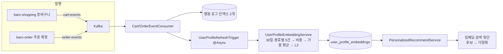

# 개인별 추천 — 행동 로그를 취향 벡터로 바꿔 추천하기

사용자가 장바구니에 담고 주문한 기록을 모아 그 사람의 취향을 768차원 벡터 하나로 표현하고, 그 벡터에 가까운 상품을 추천하는 기능이다. 이 문서를 읽으면 행동 하나가 어떤 비중으로 취향에 들어가는지, 왜 상품명을 임베딩하지 않는지, 왜 시간 감쇠·수량·검색 세 가지를 차례로 뺐는지, 그리고 이 파이프라인이 다른 모듈의 이벤트에 어떻게 기대고 있는지를 알게 된다. 값은 [스펙](../specs/taste-vector/taste-vector-pipeline.md)이 SSOT고, 한 사용자를 끝까지 따라간 숫자 예시는 [`EMBEDDING_EXAMPLE.md`](../EMBEDDING_EXAMPLE.md)에 있다.

## 목표와 하지 않는 것

**목표**

- 행동이 쌓이면 사람 개입 없이 취향 벡터가 갱신되고, 홈 화면 추천이 그것을 쓴다
- 이미 담거나 산 상품은 다시 추천하지 않는다
- 행동 기록 처리가 이벤트 소비를 느리게 하지 않는다
- 로그가 부족하면 추천하지 않는다 — 틀린 추천보다 빈 목록

**하지 않는 것**

- 검색 신호 — 2026-09-07에 뺐다. 검색 결과 상위에 뜬 상품을 취향으로 삼는 방식이었다([`005`](../audits/taste-vector/005-signal-and-weight-simplification.md))
- 수량 반영 — 같은 날 뺐다. 수량은 선호의 세기가 아니라 소비량이다
- 시간 감쇠 — 2026-09-06에 뺐다(아래 결정 3). "오래된 건 덜 본다"는 30일 조회 창이 담당
- 카테고리 선호 — 계산·가산점 모두 삭제. 벡터가 이미 그 방향이다
- 비로그인 사용자 — `X-User-Id`가 없으면 로그도 추천도 없다

## 한눈에 보는 흐름

| 단계 | 어디서 | 요약 |
|---|---|---|
| 발행 | `baro-shopping` `@TrackHistory` 3곳, `baro-order` 주문 확정 1곳 | `HistoryAspect`가 커밋 후 발행. 취소 이벤트 발행부는 아직 없다 |
| 소비 | `CartEventConsumer`·`OrderEventConsumer` | 문서 ID `{partition}-{offset}`로 재시도 시 중복 없음. 역직렬화 실패는 그 레코드만 건너뜀 |
| 갱신 예약 | `UserProfileRefreshTrigger` | 장바구니·주문 **두 경로**가 거치는 유일한 `@Async` 진입점. 큐 100건, 넘치면 버림 |
| 벡터 계산 | `UserProfileEmbeddingService` | 로그 3건 미만이면 건너뜀. 비중 = 행동 종류(0 또는 1~3) 하나 |
| 추천 | `PersonalizedRecommendService` | 프로필 없으면 빈 목록. 경험 상품 제외 → [임베딩 검색](vector-similarity.md) 뒷단 |

## 어떻게 동작하는가

아래에 나오는 수치(가중치·상한·게이트·조회 창)는 [스펙 비즈니스 규칙 표](../specs/taste-vector/taste-vector-pipeline.md#비즈니스-규칙)의 값을 옮긴 것이다 — 값이 바뀌면 스펙이 먼저다.

**로그를 두 곳에서 모은다.** 장바구니 담기·수량 변경·삭제(`baro-shopping`), 주문 확정(`baro-order`). 둘 다 Kafka 이벤트로 받는다. 2026-09-07까지는 baro-ai 자신이 검색 로그도 남겼으나 신호에서 뺐다.

**비중을 매긴다.** 주문 확정 3, 담기 2, 수량 변경 1, 삭제·취소 0. 이 값이 곧 최종 비중이다 — 곱하는 축이 없다. 비중 0인 로그는 평균에서도, "이미 경험한 상품" 목록에서도 뺀다 — 관심이 없어진 상품은 다시 추천에 나와도 된다.

**벡터를 섞는다.** 로그에 등장한 상품이 색인 때 이미 갖고 있는 벡터를 비중대로 더한 뒤 길이를 1로 맞춘다(L2 정규화). 외부 임베딩 API를 부르지 않는다. 벡터가 없는 상품은 건너뛰고, 쓸 수 있는 벡터가 하나도 없으면 저장하지 않는다.

**추천한다.** 프로필 벡터를 기준으로 담거나 산 상품을 뺀 뒤 [임베딩 검색](vector-similarity.md)과 같은 경로(후보 조회 → 다양화)를 탄다.

## 핵심 설계 결정

### 1. 상품명을 반복한 텍스트를 임베딩하지 않고, 상품 벡터를 가중 평균한다

- **문제**: 처음 설계는 "상품명을 비중만큼 반복한 긴 문장"을 만들어 Gemini 임베딩에 보냈다. "사과 사과 사과 바나나"가 사과 쪽으로 3배 기울 거라는 가정인데, 그건 임베딩 모델의 계약이 아니다. 게다가 행동 1건마다 원격 호출 6회로 프로필 전체를 다시 계산했다.
- **대안**: (a) 반복 텍스트 유지 + 캐시 (b) 로그 상품의 기존 벡터를 가중 평균 (c) 검색어만 따로 임베딩.
- **선택**: (b). 가중치가 수식 그대로 곱해지고 임베딩 호출이 0이 된다.
- **근거**: 감사 [`taste-vector/001`](../audits/taste-vector/001-profile-refresh-path.md) A-3 재설계(2026-09-05 승인). 같은 감사에서 장바구니 가중치가 **문자열 불일치로 전부 1**이던 결함(A-1)도 발견됐다 — 컨슈머는 `"ADD"`를 저장하고 계산은 `"CART_ITEM_ADDED"`와 비교하고 있었다.
- **대가**: 벡터 없는 상품은 취향에 기여하지 못한다.

### 2. `@Async`는 별도 빈을 거쳐야 실제로 비동기다

- **문제**: 컨슈머 두 곳이 같은 클래스 안에서 `@Async` 메서드를 불렀다. Spring AOP 프록시는 자기 호출을 가로채지 못해 **Kafka 리스너 스레드에서 동기로** 프로필을 계산하고 있었다.
- **선택**: `UserProfileRefreshTrigger`를 유일한 진입점으로 분리. 큐가 차면 예외 대신 로그만 남기고 버린다 — 예외를 던지면 컨슈머 재시도 폭풍이 되고, 프로필은 다음 행동에서 어차피 재계산된다.
- **대가**: 큐 초과 시 그 갱신이 사라진다. 허용 손실로 문서화했다. 유입이 장바구니·주문 이벤트뿐이라 실제로 넘칠 빈도는 아니다(2026-09-07 실측 — 검색 963회에 폐기 0건).

### 3. 시간 감쇠 축을 뺐다 — 계산은 하는데 결과에 영향이 없었다

- **문제**: 비중에 "최근일수록 3.0, 7일마다 절반, 하한 0.3"을 곱하고 있었다. 그런데 로그를 종류별 최근 5건만 읽으니 한 번의 쇼핑 로그는 전부 같은 시간대라 감쇠값이 같고, 마지막 L2 정규화가 같은 배수를 소거한다. 30일을 읽는데 감쇠는 23일에 바닥이라 마지막 일주일은 평지였다.
- **대안**: (가) 삭제 (나) 로그 창을 20건으로 늘려 축이 작동할 재료를 준다 (다) 유지.
- **선택**: (가). 사용자 결정.
- **근거**: 감사 [`taste-vector/002`](../audits/taste-vector/002-weight-axes-and-tests.md) F-1·F-2 — 계산기로 재현되는 사실. 삭제 근거 자체를 테스트로 남겼다(`blend_uniformScalingCancelsOut`: 모든 비중에 3을 곱해도 결과 벡터가 같다).
- **대가**: 이론적으로 여러 날에 걸친 로그가 섞이면 시간 축이 의미가 있었을 것이다. 지금 구조에서는 그 경우가 드물다는 판단이다.

### 4. 로그 3건 미만이면 프로필을 만들지 않는다

- **선택**: 장바구니+주문 합계 3건 미만이면 건너뛴다. 삭제만 있는 사용자는 비중이 전부 0이라 저장하지 않는다.
- **근거**: 1~2건으로 만든 벡터는 그 상품 하나를 다시 추천하는 것과 다르지 않다. 값 3은 측정이 아니라 판단이다 — 개인화 골든셋이 생기면 재본다.

### 5. 스레드 풀은 "최대 5개"로 적혀 있지만 실제로는 2개로 돈다

- **사실**: `AsyncConfig`는 상주 2 / 최대 5 / 대기열 100이다. 자바 `ThreadPoolExecutor`는 **상주 스레드가 다 차면 대기열부터 채우고, 대기열이 가득 차야 최대치까지 늘린다.** 즉 3~5번째 스레드는 대기 작업이 100건 쌓인 뒤에야 생기고 그 전까지는 항상 2개다. "부하가 오르면 5개까지 는다"고 읽으면 틀린다.
- **왜 이대로 두는가**: 이 풀이 맡은 일(프로필 벡터 재계산)은 사용자를 기다리게 하지 않고 유실도 허용된다. 스레드를 늘려 동시 ES 쓰기를 키우는 것보다, 상시 2개로 꾸준히 처리하며 순간 몰림을 대기열로 흡수하는 편이 맞다.
- **한 번 뒤집혔다가 되돌아왔다**: 2026-09-06 실측에서 제출의 37~65%가 폐기되는 것을 확인해 "이 설정은 틀렸다"고 적었다. 그런데 그 유입의 대부분이 검색이었고, 2026-09-07에 검색을 신호에서 빼자 **같은 설정에서 폐기가 0건**이 됐다(회원 검색 963회). 고쳐야 했던 것은 풀이 아니라 **무엇을 그 풀에 넣는가**였다. 근거: [`003`](../audits/taste-vector/003-shared-executor-saturation.md) · [`005`](../audits/taste-vector/005-signal-and-weight-simplification.md)
- **교훈**: 큐가 넘칠 때 늘려야 할 것을 먼저 보지 말고, 넣고 있는 것이 들어갈 가치가 있는지를 먼저 볼 것.
- **대가**: 설정만 보고 "5스레드까지 확장된다"고 읽는 사람이 생긴다. 그래서 여기 적어 둔다.

## 실측 근거

| 무엇 | 결과 | 원본 |
|---|---|---|
| 시간 축 하한 도달 시점 | 168·log₂(10) ≈ 558시간 ≈ 23.3일 | [`taste-vector/002`](../audits/taste-vector/002-weight-axes-and-tests.md) F-2 |
| 비중 범위 | 시간 축이 있던 때 0.3~45(150배) → 수량 축까지 뺀 지금 **0 또는 1~3** | 같은 문서 F-3, [`005`](../audits/taste-vector/005-signal-and-weight-simplification.md) A-2, `UserProfileEmbeddingServiceTest` |
| 갱신 1회의 원격 호출 | 재설계 전 6회(ES 5·Gemini 1) → 재설계 후 5회(ES만) → **검색 신호를 뺀 지금 4회**(로그 조회 2 + 상품 벡터 1 + 저장 1, 임베딩 0) | [`taste-vector/001`](../audits/taste-vector/001-profile-refresh-path.md) A-3 · [`005`](../audits/taste-vector/005-signal-and-weight-simplification.md) A-1 |

개인화 추천 **품질**은 아직 잰 적이 없다 — 골든셋이 없다. 이 단위의 숫자는 전부 계산 구조에 관한 것이다.

## 운영·장애 관점

| 상황 | 동작 |
|---|---|
| 프로필 없음 | 빈 목록(200) — 홈 화면을 죽이지 않는다 |
| 깨진 이벤트 | `ErrorHandlingDeserializer`가 그 레코드만 건너뜀. 처리 실패는 1초 간격 2회 재시도 후 건너뜀 |
| 재시도로 같은 이벤트 두 번 | 문서 ID가 `{partition}-{offset}`라 덮어쓴다 |
| 갱신 큐(100) 초과 | 로그 후 폐기. 다음 행동에서 재계산 |
| 저장 직후 조회 | ES refresh(1초) 안이면 방금 쓴 로그를 못 볼 수 있다 — 다음 갱신에서 따라잡음 |
| 인덱스 | `cart_event_logs`·`order_event_logs`·`user_profile_embeddings` 3개. 저장 형식이 바뀌어 재생성 필요(미실행). `search_logs`는 코드가 더 이상 만들지도 읽지도 않아 **삭제 대상**이다 |

## 알려진 한계·다음 단계

- **품질 골든셋이 없다.** 가중치 3/2/1과 게이트 3건은 판단값이고, 개인화 추천 품질을 한 번도 재지 않았다. 2026-09-07에 검색 신호와 수량 축을 뺀 것도 신호의 성질에 근거한 판단이지 품질 측정이 아니다.
- **주문 취소 이벤트를 발행하는 곳이 없다.** `ORDER_CANCELLED` 분기는 지금 도달 불가 — 발행 모듈 확인 대기.
- **신규 사용자는 프로필이 늦게 생긴다.** 검색을 뺐으므로 장바구니·주문 3건이 쌓여야 한다. 상품 조회 이벤트를 받으면 풀리지만 발행 모듈 변경이 필요하다(`open-items.md` C-21).
- **`X-User-Id`를 게이트웨이가 검증하지 않는다.** 남의 ID로 추천을 조회할 수 있다(검색 로그 오염은 신호 제거로 사라졌다).
- **게스트 행동은 취향에 없다.** 로그인 후 장바구니 병합 시 담기 이벤트가 나지 않는다.
- ~~**장바구니 이벤트의 `categoryCode`는 저장만 되고 읽는 곳이 없다.**~~ **2026-09-07 해소** — 수량과 함께 수신·저장 양쪽에서 뺐다. 카테고리 선호를 쓰기로 하면 상류가 계속 보내고 있으므로 수신 모델에 한 줄을 되살리면 된다.

## 관련 문서·코드

- 스펙: [`specs/taste-vector/taste-vector-pipeline.md`](../specs/taste-vector/taste-vector-pipeline.md)
- 예시: [`EMBEDDING_EXAMPLE.md`](../EMBEDDING_EXAMPLE.md)
- 감사: [`audits/taste-vector/001`](../audits/taste-vector/001-profile-refresh-path.md) · [`002`](../audits/taste-vector/002-weight-axes-and-tests.md) · [`003`](../audits/taste-vector/003-shared-executor-saturation.md) · [`004`](../audits/taste-vector/004-executor-fix-measurement.md) · [`005`](../audits/taste-vector/005-signal-and-weight-simplification.md)
- 반영 이력: [`audits/taste-vector/refactor-log.md`](../audits/taste-vector/refactor-log.md)
- 코드: `event.consumer.CartEventConsumer`·`OrderEventConsumer`, `log.application.LogWriteService`, `embedding.application.UserProfileRefreshTrigger`·`UserProfileEmbeddingService`, `recommend.application.PersonalizedRecommendService`, `config.AsyncConfig`
- 발행 측: `baro-common` `HistoryAspect`, `baro-shopping` `CartService`, `baro-order` `InventoryConfirmedConsumer`
