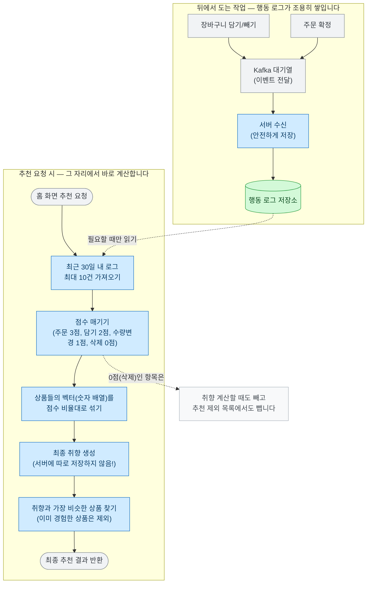

# 개인별 추천 (Taste Vector)

사용자가 장바구니에 상품을 담거나 구매했던 행동 기록을 바탕으로, 이 사람의 '취향'을 분석해 딱 맞는 상품을 추천해 주는 기능이에요. 이 문서를 읽으시면 사용자의 수많은 행동 기록이 어떻게 하나의 '취향'으로 묶이는지, 그리고 어떤 똑똑한 과정을 거쳐 상품을 골라오는지 쉽게 이해하실 수 있어요.

## 목표와 하지 않는 것

**목표 (우리가 하려는 것)**
- 사용자의 행동(장바구니 담기, 빼기, 구매 등)을 실시간으로 수집하여 안전하게 보관해요.
- 사용자가 앱 메인 홈 화면을 열 때, 눈 깜짝할 새에 가장 추천할 만한 상품을 뽑아냅니다.
- 서버가 느려지거나 에러가 나더라도 '개인별 추천' 영역만 살짝 비워둘 뿐, 홈 화면 전체가 에러 나지 않게(500 에러 방지) 보호해요.

**하지 않는 것 (의도적으로 뺀 것)**
- **클릭(조회)이나 검색은 반영하지 않아요:** 클릭이나 검색을 너무 많이 쌓으면 서버가 힘들어하고, 검색 결과 첫 페이지에 뜬 상품을 클릭했다고 해서 온전히 사용자의 취향이라고 보기도 어렵기 때문이에요. 오직 '구매'나 '장바구니 담기'처럼 확실한 의사 표현만 점수에 반영해요.
- **수량은 따지지 않아요:** "사과를 10박스 샀으니까 사과를 10배 더 좋아해"라고 단정 지을 수 없으므로, 수량 자체는 점수화하지 않아요.
- **오래된 기록이라고 점수를 깎지 않아요:** 어차피 최근 30일(최대 10건)의 최신 데이터만 모아서 분석하기 때문에, 날짜별로 가중치를 다르게 두는 복잡한 계산은 뺐어요.

## 한눈에 보는 흐름

사용자 모르게 뒤에서 행동 로그가 쌓이는 '저장 경로'와, 추천 요청이 왔을 때 번개처럼 취향을 계산해 내는 '조회 경로'로 나뉩니다.

여기서 가장 중요한 핵심은 **외부 AI(Gemini)를 부르는 과정이 아예 없다는 것**이에요. 상품이 등록될 때 만들어둔 벡터 숫자들을 서버 안에서 '비율대로 섞기(가중 평균)'만 하기 때문에 무척 빠르고 통신 비용도 전혀 안 들어요. 장바구니에서 뺀 상품(0점)은 "이 사람이 이미 본 상품" 목록에서도 지워주어, 나중에 다시 마음이 바뀌었을 때 편하게 추천받을 수 있도록 배려했어요.

## 어떻게 동작하나요?

- **행동 모으기:** 장바구니 담기, 빼기, 주문 확정 이벤트가 발생할 때마다 빠짐없이 주워 담어요. 
- **점수 매기기:** 주문 확정은 3점, 담기는 2점, 수량 변경은 1점, 삭제는 0점을 줘요.
- **취향 섞기(가중 평균):** 사용자가 반응한 상품들이 원래 가지고 있던 벡터(숫자 배열)들을 위에서 매긴 점수 비율대로 곱해서 섞어요. 만약 행동 기록이 너무 적으면(3건 미만) 억지로 추천하지 않고 아예 빈 결과를 돌려줘요. **재미있는 점은, 이렇게 계산한 사용자의 최종 취향 결과를 서버 DB에 영구 저장하지 않는다는 거예요.** 굳이 저장하지 않아도 요청이 올 때마다 그때그때 눈 깜짝할 새에 계산할 수 있기 때문이에요.
- **추천해주기:** 만들어진 취향 벡터와 가장 비슷한 성향을 가진 상품들을 찾아줘요. 단, 방금 점수 계산에 쓰였던 상품들(이미 사거나 장바구니에 담은 것)은 추천 목록에서 센스 있게 빼고 보여줘요.

## 핵심 설계 결정

### 1. 취향 텍스트를 AI에게 묻지 않고, 서버에서 수학 기법으로 섞어냅니다.
- **문제점:** 원래는 사용자가 행동한 상품 이름들을 비중만큼 이어 붙여서("사과 사과 바나나") 외부 AI(Gemini)에게 취향을 분석해 달라고 요청했어요. 이렇게 하니 행동 한 건이 추가될 때마다 외부 호출이 발생해 서버가 느려졌어요.
- **해결책:** 이미 각 상품에 정교하게 만들어둔 벡터 값(숫자 배열)이 있으므로, 이 숫자들을 서버 내부에서 점수(가중치)만큼 곱해서 평균을 내는 수학적인 방식으로 바꿨어요.
- **효과:** 외부 API 호출이 0번이 되어서 시스템이 훨씬 가볍고 쾌적해졌어요.

### 2. 비동기 갱신 대기열 시스템 자체를 걷어냈어요.
- **문제점:** 예전에는 사용자가 행동할 때마다 미리 취향 벡터를 계산해서 저장해두려 했어요. 서버가 버거워지면 에러가 나지 않게 잠시 큐(대기열)에 쌓아두는 복잡한 비동기 방식을 썼죠.
- **해결책:** 굳이 미리 저장해둘 필요 없이, '추천 요청이 들어왔을 때' 실시간으로 계산하는 것으로 바꿨어요. 
- **효과:** 대기열에 쌓고 기다리는 복잡한 과정과 거기서 나던 데이터 유실이 통째로 사라졌어요. 외부 AI 호출이 없어져 남은 일이 **DB 조회 2번과 숫자 평균 계산**뿐이라, 미리 계산해 둘 이유가 없다고 판단했어요.
- **아직 확인 못 한 것:** 그 계산이 실제로 몇 밀리초 걸리는지는 **아직 재보지 않았어요.** 지금 규모에선 문제없다고 봤지만 측정한 값은 아니에요.

### 3. '오래된 기록일수록 점수를 깎는 기능(시간 감쇠)'을 지웠어요.
- **문제점:** 예전엔 너무 옛날 기록은 점수를 깎아서 최신 취향을 돋보이게 하려는 수식이 있었어요. 
- **해결책:** 어차피 우리는 최근 30일 이내의 로그 10건만 모아서 계산해요. 거의 같은 시기에 일어난 행동들이라 시간별로 점수를 차등하는 게 별 의미가 없었죠. 그래서 헷갈리기만 하는 시간 감쇠 수식을 깔끔하게 지웠어요.

### 4. 로그가 3건 미만이면 억지로 분석하지 않아요.
- **이유:** 고작 1~2건 장바구니에 담은 것만으로 전체 취향을 분석하면, 방금 담은 그 상품과 비슷한 것만 줄창 추천되겠죠? 그건 진정한 개인별 추천이 아니라고 판단해, 3건 미만일 때는 아예 추천 영역을 비워두기로 했어요.

### 5. 스레드 풀 튜닝 삽질, 그리고 본질 깨닫기
- **배경:** 시스템이 버벅거릴 때 '비동기 스레드 풀(서버 일꾼 수) 설정이 잘못되었나?' 하고 열심히 고치려고 애썼어요. 그런데 진짜 문제는 일꾼 숫자가 아니라 **'클릭조차 안 한 쓸데없는 검색 데이터들을 너무 많이 분석하고 있었다'**는 거였어요.
- **해결:** 검색 기록을 취향 분석에서 아예 빼버리자, 시스템 버벅거림(버려지는 에러 693건)이 거짓말처럼 사라졌어요. 무언가를 빠르게 처리하려고 시스템을 튜닝하기 전에, **'이걸 굳이 지금 처리해야 하는 의미 있는 데이터인가?'**를 먼저 물어봐야 한다는 큰 교훈을 얻었어요.

## 측정 결과 (데이터)

| 측정 내용 | 결과 |
|---|---|
| 프로필 계산 1회당 서버 간 통신 횟수 | 옛날 방식: 6번(AI 호출 포함) → **개선 후: 2번 (AI 호출 0번, DB 조회 2번만 수행)** |
| 취향 분석 시 사용되는 점수 범위 | 옛날 방식: 0.3점 ~ 45점(150배 차이)로 복잡함 → **개선 후: 0점, 혹은 1~3점으로 직관적이고 안정화됨** |
| 검색 데이터 폐기 건수 | 무리한 비동기 작업으로 조용히 버려지던 에러 **693건 → 0건**으로 깔끔하게 해결 |

*(단, 알고리즘 변경으로 인한 '실제 추천 상품의 만족도(품질)'는 평가할 명확한 정답지(골든셋)가 아직 없어 정확히 재진 못했어요. 위 데이터는 철저히 시스템 아키텍처와 속도 효율에 대한 성과이에요.)*

## 운영 및 장애 대응 가이드

- **아직 취향 프로필이 안 만들어진 신규 사용자라면?** -> 에러를 내지 않고 빈 목록을 돌려주어 홈 화면이 죽지 않게 해요.
- **Kafka 이벤트(메시지)가 깨져서 들어온다면?** -> 시스템 전체가 막히지 않게, 2번 다시 시도해보고 안 되면 에러 보관함(`.DLT`)으로 옮깁니다.
- **저장되자마자 바로 조회하면?** -> 검색 엔진에 저장 반영되는 1초 사이에 조회가 일어나면 아주 방금 전 행동은 반영이 안 될 수 있어요. 이는 시스템 한계로 허용하며 다음 요청 때 자연스럽게 반영돼요.

## 알려진 한계와 다음 단계

- **추천 '품질'을 객관적으로 잴 방법이 없어요:** 시스템 구조는 환골탈태했지만, 이게 정말 사용자 마음에 쏙 드는 추천인지 점수를 매길 정답지가 아직 없어요. 다음 단계의 최우선 과제이에요.
- **신규 사용자는 추천받기까지 꽤 오래 걸려요:** 검색 기록을 빼버렸기 때문에, 장바구니/주문이 3건 이상 쌓여야만 비로소 추천이 시작돼요. 나중에 '상품 상세페이지 클릭(조회)' 이벤트를 추가로 받게 되면 금방 해결될 문제이에요.
- **비로그인(게스트)은 취향 분석이 안 돼요:** 아직 로그인 전 유저의 임시 장바구니 행동을 추적할 수 있는 데이터가 넘어오지 않아서 대응하지 못하고 있어요.

## 연관된 문서 및 코드 모음

- 스펙 문서: [`specs/taste-vector/taste-vector-pipeline.md`](../specs/taste-vector/taste-vector-pipeline.md)
- 전체 성능 기록(감사): [`audits/taste-vector/001-profile-refresh-path.md`](../audits/taste-vector/001-profile-refresh-path.md)
- 취향 점수 변화 예시 가이드: [`EMBEDDING_EXAMPLE.md`](../EMBEDDING_EXAMPLE.md)
