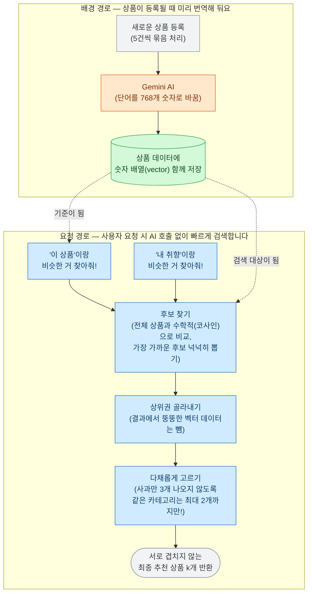

# 임베딩 검색 — 비슷한 상품을 똑똑하게 추천하기

상품 이름을 768개의 숫자 배열(벡터)로 바꿔서 저장해 두고, 이 숫자가 비슷한 상품들을 찾아내 추천해 주는 기능이에요. '비슷한 상품 추천(상품 상세 페이지)'과 '개인별 취향 추천(홈 화면)'이 모두 이 똑같은 검색 엔진을 뒤에서 공통으로 사용해요.
이 문서를 읽으시면 "어떻게 컴퓨터가 상품끼리 비슷하다는 걸 알 수 있는지", "비슷한 사과만 3개 연속으로 뜨지 않게 하려면 어떻게 해야 하는지", 그리고 "왜 검색 속도를 높이는 최신 기술(HNSW)을 굳이 안 쓰기로 했는지" 알 수 있어요.
구체적인 값이나 규칙은 [스펙 문서](../specs/vector-similarity/vector-similarity-search.md)를 참고해 주세요!

## 목표와 하지 않는 것

**목표 (우리가 하려는 것)**
- 상품 상세 페이지 하단에, 지금 보는 상품과 비슷하면서도 서로 다채로운 상품을 k개 보여줘요.
- 만약 AI 장애로 숫자 배열(벡터)을 갖지 못한 상품이 섞여 있더라도, 추천 시스템 전체가 에러 나지 않고 부드럽게 넘어가게 만들어요.
- '상품'을 기준으로 검색하든 '내 취향'을 기준으로 검색하든, 뒷단에서는 똑같은 로직을 태워서 유지보수를 쉽게 해요.

**하지 않는 것 (의도적으로 뺀 것)**
- **하이브리드 검색(텍스트 + 벡터 동시 검색)은 안 해요:** 일반 검색창에서는 키워드로만 찾고, 추천 영역에서는 벡터로만 찾게 딱 선을 그었어요.
- **카테고리에 추가 점수를 주지 않아요:** 숫자 배열(벡터) 안에 이미 '이게 과일인지, 고기인지'에 대한 의미가 녹아있어서 굳이 카테고리 점수를 또 줄 필요가 없어요.
- **사용자가 요청할 때 AI(Gemini)를 부르지 않아요:** 모든 상품 벡터는 상품이 등록될 때 미리 만들어 둬요. 사용자가 추천을 누를 때마다 AI를 부르면 너무 느리고 비싸기 때문이에요.

## 한눈에 보는 흐름

숫자 배열(벡터)이 '미리' 만들어지는 과정과, 사용자가 '추천해줘!' 했을 때 상품을 골라내는 과정을 그린 그림이에요.

그림에서 보시듯, '상품 기준 추천'이든 '취향 기준 추천'이든 일단 뒤로 넘어오면 완전히 똑같은 과정을 거쳐요. 가장 중요한 건, 사용자 요청이 들어왔을 때 주황색 박스(AI 호출)가 없다는 거예요. 미리 만들어둔 숫자들끼리 거리만 수학적으로 재면 돼서 아주 빨라요. 마지막의 "다채롭게 고르기"가 꽤 중요한데요, 이 과정이 없으면 사과를 눌렀을 때 추천 상품이 "청송 사과, 꿀 사과, 부사 사과"로 도배되어 버리거든요.

## 어떻게 동작하나요?

(여기에 나오는 구체적인 숫자 값은 [스펙 문서](../specs/vector-similarity/vector-similarity-search.md#비즈니스-규칙)를 따라요.)

- **벡터화(임베딩):** "청송 꿀사과"라는 텍스트를 AI에게 주면 768개의 숫자를 돌려줘요. 신기하게도 "홍로 사과"를 주면 아까와 아주 비슷한 숫자를 주고, "한우 등심"을 주면 완전히 다른 숫자를 줘요. 이 숫자들을 상품 정보와 함께 데이터베이스에 잘 저장해 둬요.
- **후보 찾기 (검색):** 사용자가 추천을 요청하면, 데이터베이스에 있는 '판매 중인 모든 상품'과 기준 숫자를 전부 일일이 비교해요(코사인 유사도 방식). 대충 비슷한 걸 찾는(근사 탐색) 게 아니라, 진짜로 하나하나 정확하게 다 계산해서 가장 비슷한 상품들을 찾아냅니다. 앱에 돌려줄 때는 용량이 큰 숫자 배열 데이터는 쏙 빼고 줘요.
- **다채롭게 고르기 (카테고리 분산):** 가장 비슷한 상품들을 주르륵 세워놓고 순서대로 고릅니다. 단, "같은 카테고리의 상품은 최대 2개까지만" 담어요. 이렇게 하면 사과 2개가 담긴 후에는 다른 과일이나 연관된 다른 상품이 담기게 되어서 훨씬 보기 좋은 추천 목록이 완성돼요.

## 핵심 설계 결정

### 1. 최신 고속 검색 기술(HNSW)을 쓰지 않고, 무식하지만 정확하게 전체를 다 비교해요.
- **문제점:** 원래 벡터 검색은 데이터가 너무 많아서 대충 빠르게 찾는 기술(HNSW 등)을 쓰는 게 정석이에요. "우리는 왜 그 좋은 기술을 안 쓰냐"는 지적이 있었어요.
- **해결책:** 일단 데이터 1만 건을 넣고 속도 측정을 해봤어요. 그랬더니 HNSW 고속 기술을 쓰나, 전체를 다 일일이 계산하나 0.007초(7ms)로 속도가 똑같이 빨랐어요. 10만 건이 넘어가야 비로소 차이가 났죠.
- **결론:** 굳이 세팅하기 복잡하고 오차가 생길 수 있는 고속 기술을 당장 도입할 필요가 없다고 판단했어요. 1만 건까지는 지금처럼 정확하게 다 비교해도 충분히 빨라요.!

### 2. 다양하게 고르기 전략 변경: 복잡한 수학식에서 "카테고리당 최대 2개"로!
- **처음 판단:** '이미 고른 상품과 가장 멀리 떨어진 상품'을 고르는 복잡한 방식(199줄)을 쓰고 있었어요. 비용이 크다는 건 알고 있어서, **효과(같은 카테고리가 얼마나 줄어드나)와 대가(원래 상품과 얼마나 멀어지나)를 둘 다 재봤고, 결과는 "유지하는 게 낫다"**였어요.
- **사흘 뒤 뒤집었어요:** 코드를 다시 읽다가 이 알고리즘이 **1위를 고른 뒤부터는 기준 상품을 아예 보지 않는다**는 걸 발견했어요. 사과 페이지에서 "사과랑 비슷한 것"을 물었는데 2위부터는 "앞서 고른 것과 안 닮은 것"만 찾고 있었던 거죠. **제가 고른 지표가 알고리즘이 하는 일 자체를 검사하지 않았어요.**
- **해결책:** "비슷한 순서는 그대로 두되, 같은 카테고리는 2개까지만"이라는 단순한 룰로 바꿨어요.
- **효과:** 무거운 숫자 데이터를 주고받을 이유가 사라졌어요. **다만 새 방식이 쏠림을 실제로 얼마나 줄이는지는 아직 재지 않았어요** — 옛 수치(45%→11.5%)는 지워진 알고리즘의 것이라 그대로 쓸 수 없어요.

### 3. 에러를 뿜어내는 AI 실패 데이터 대처법
- **문제점:** 만약 어떤 상품이 AI 오류로 벡터 값을 못 가졌다면, 데이터베이스 검색 엔진(ES)은 그 상품을 발견하는 순간 에러를 내뿜고 추천 시스템 전체를 멈춰버렸어요.
- **해결책:** 검색 엔진에 쿼리를 날릴 때 "벡터 값이 있는 상품만 검사해라"라는 필터(`exists(vector)`)를 하나 딱 꽂아 넣었어요. 이제 벡터가 없는 상품은 부드럽게 무시하고 검색이 씽씽 돌아가요.

## 실측 근거 (데이터)

| 측정 내용 | 결과 | 상세 근거 링크 |
|---|---|---|
| HNSW(고속) vs 전체 비교 속도 (1만 건) | HNSW: 6.4ms vs 전체 비교: **7.4ms (별 차이 없음)** | [성능 측정 로그](../audits/vector-similarity/vectorbench/knn-bench-20260906-145920.json) |
| HNSW(고속) vs 전체 비교 속도 (10만 건) | HNSW: 32ms vs 전체 비교: **92ms (이때부터 차이가 커짐)** | 위와 동일 |
| 데이터 다이어트 전후 응답 크기 | 벡터 포함 시 1MB (엄청 무거움) → 포함 안 할 시 **약 2KB (깃털처럼 가벼움)** | 위와 동일 |

## 운영 및 장애 대응 가이드

| 상황 | 어떻게 동작하나요? |
|---|---|
| 기준 상품이 없거나, 벡터값이 없을 때 | 에러가 나는 대신 조용히 빈 배열(200)을 돌려줘요. 상품 상세 페이지 화면이 에러 때문에 안 뜨는 걸 막아주죠. |
| 데이터베이스(ES) 검색에 실패했을 때 | 이럴 땐 빈 배열로 숨기지 않고 정직하게 503 에러(서버 오류)를 내서 개발자가 바로 알 수 있게 해요. |
| 클라이언트가 상품 100개를 추천해 달라고 할 때 | 우리가 정해둔 룰(1~50개)을 벗어나면, 검색을 아예 시도하지 않고 바로 400 에러(잘못된 요청)를 튕겨냅니다. |

## 알려진 한계와 다음 단계

- **"카테고리당 2개" 방식이 정말 효과적인지는 테스트해봐야 해요:** 예전의 복잡한 방식보다 시스템 성능이 좋아진 건 맞지만, 고객이 봤을 때 정말 추천이 다채로워 보이는지는 나중에 실제 상품 데이터가 꽉 차면 다시 검증해 봐야 해요.
- **데이터가 10만 개가 넘어가면 쿼리를 수정해야 해요:** 지금은 전체 상품을 무식하게 비교해도 빠르지만, 나중에 장사가 잘돼서 상품이 10만 건이 넘어가면 다시 전체 시스템 속도를 측정해보고 HNSW 같은 고속 기술로 전환을 진지하게 고민해야 해요. (그때그때 수동으로 상품 수를 모니터링해야 하는 한계가 있어요.)
- **벡터 검색 속도를 실시간으로 모니터링하는 지표가 없어요:** 지금은 에러 카운트만 세고 있고, 이 추천 검색이 0.1초 만에 끝났는지 1초가 걸렸는지 그라파나 같은 대시보드에서 볼 수 있는 지표 연동이 아직 안 되어 있어요. 

## 연관된 문서 및 코드

- 스펙 문서: [`specs/vector-similarity/vector-similarity-search.md`](../specs/vector-similarity/vector-similarity-search.md)
- 결정 기록: [`decisions/004`](../decisions/004-script-score-over-knn.md) 등
- 감사 문서: [`audits/vector-similarity/001`](../audits/vector-similarity/001-vector-search-and-diversity.md) 등
- 소스 코드: `search.application.VectorProductSearchService`, `recommend.application.VectorRecommendPipeline` 등
