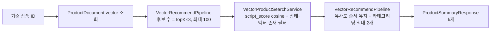

# 임베딩 검색 — 상품 벡터·유사 상품 추천·다양화

상품명을 768차원 벡터로 만들어 상품 문서에 함께 저장하고, 어떤 기준 벡터(상품 하나 또는 사용자 취향)에 가까운 상품을 찾은 뒤 서로 겹치지 않게 골라 주는 기능이다. 상품 상세 페이지의 "비슷한 상품"이 직접 소비자이고, [개인별 추천](taste-vector.md)도 같은 뒷단을 쓴다. 이 문서를 읽으면 "비슷하다"를 어떻게 계산하는지, 왜 근사 탐색(HNSW, Hierarchical Navigable Small World 그래프)으로 바꾸지 않았는지, 다양화가 실제로 무엇을 바꾸는지를 알게 된다. 값은 [스펙](../specs/vector-similarity/vector-similarity-search.md)이 SSOT다.

## 목표와 하지 않는 것

**목표**

- 상품 상세에서 그 상품과 비슷하되 서로 다른 상품 k개를 보여 준다
- 벡터를 만들지 못한 상품이 섞여 있어도 검색이 실패하지 않는다
- 기준 벡터의 출처(상품 벡터·취향 벡터)와 무관하게 같은 경로를 쓴다

**하지 않는 것**

- 텍스트 검색과 벡터 검색의 혼합(hybrid search) — 검색은 키워드만, 추천은 벡터만
- 카테고리 가산점 — 2026-09-05에 삭제했다. 벡터가 이미 그 방향으로 기울어 있어 정보가 중복이었다
- 요청 시점 임베딩 — 벡터는 색인 때 한 번 만든다. 요청 경로에 Gemini 호출이 없다

## 한눈에 보는 흐름

| 단계 | 어디서 | 요약 |
|---|---|---|
| 임베딩 | `ProductEmbeddingService` (색인 시) | `gemini-embedding-001`, 출력 차원 768 고정. 묶음당 1회 |
| 기준 벡터 | `SimilarProductRecommendService` | 기준 상품 문서에서 벡터를 읽는다. 없으면 빈 목록 |
| 후보 조회 | `VectorProductSearchService` | 판매 중·벡터 있는 문서 전부를 코사인으로 채점, 상위 topK×3 |
| 고르기 | `VectorRecommendPipeline` | 유사도 순서를 지키며 카테고리당 2개까지 담고, 모자라면 남은 후보로 채운다 (2026-09-09 이전에는 서로 먼 것을 고르는 방식) |

## 어떻게 동작하는가

아래에 나오는 수치(차원·후보 배수·상한)는 [스펙 비즈니스 규칙 표](../specs/vector-similarity/vector-similarity-search.md#비즈니스-규칙)의 값을 옮긴 것이다 — 값이 바뀌면 스펙이 먼저다.

**벡터.** 상품명 텍스트를 Gemini 임베딩 모델에 보내 768개 숫자로 받는다. "청송 꿀사과"와 "홍로 사과"는 가까운 벡터가 되고 "한우 등심"은 멀다. ES 매핑은 `dense_vector`, `dims=768`이고 `index`·`similarity`는 서버 기본값(8.12·9.1 모두 `index=true`, cosine)이다.

**후보 조회.** `script_score` 쿼리로 필터(판매 중, 벡터 존재)를 통과한 문서 전부의 코사인 유사도를 계산한다. 정확 계산이지 근사가 아니다. 점수는 `cos + 1.0`으로 0~2 범위에 놓는다(ES는 음수 점수를 허용하지 않는다). 기준 상품 자신과 이미 담은 상품은 `must_not`으로 뺀다. 응답은 벡터를 포함해 받는다 — 다음 단계가 필요로 한다.

**고르기(카테고리 상한).** 유사도 상위 k개를 그대로 보여 주면 "청송 사과·부사 사과·홍로 사과"가 도배된다. 2026-09-09부터는 후보를 유사도 순서대로 훑으며 **카테고리당 2개까지만** 담고, 그래도 k개가 안 되면 남은 후보로 채운다(`VectorRecommendPipeline.selectWithCategorySpread`). 그전(2026-09-06~08)에는 아래처럼 서로 먼 것을 고르는 max-min 방식이었다 — 후보를 k×3개 가져와 (1) 1위를 고정하고 (2) 남은 후보 중 "이미 고른 것들과의 최소 거리"가 가장 큰 것을 차례로 고른 뒤 (3) 화면용으로 기준과의 유사도순으로 다시 정렬한다. 후보가 k 이하면 다양화 없이 그대로다.

## 핵심 설계 결정

### 1. HNSW `knn`으로 바꾸지 않는다 — 상품 수를 3단계로 재고 정했다

- **문제**: ES는 벡터를 저장할 때 근사 탐색 구조(HNSW 그래프)를 기본으로 만드는데, 우리 조회는 그 구조를 안 쓰고 전부 비교한다. "만들어 놓고 안 쓴다"는 지적은 맞다.
- **대안**: (a) 지금 `knn`으로 전환 (b) 상품 수 예상치를 물어 정한다 (c) 그래프 생성을 끈다.
- **선택**: 유지. 결론 규칙을 **재기 전에** 적었다 — "1만 건에서 p95 50ms 미만이면 전환 안 함".
- **근거**: 1천·1만·10만 건 난수 벡터로 실측. 1만 건 p95 **7.4ms**(script_score) vs 6.4ms(knn) — 같다. 10만 건에서야 92ms vs 32ms로 갈린다. 지금 이득이 0이고, Spring Data ES 5.3.6은 최상위 `knn` 빌더가 없어 우회 코드까지 필요하다. [`decisions/004`](../decisions/004-script-score-over-knn.md).
- **대가**: 상품이 수만 건을 넘으면 다시 열어야 하고, 그걸 알려 주는 장치는 없다. 그때는 `num_candidates`를 k의 5배로 줘야 하고(2배는 오히려 느렸다) 실데이터 일치율을 다시 봐야 한다.

### 2. (2026-09-06 시점) 다양화를 유지하고, 후보 배수 3을 실측으로 확정했다 — 2026-09-09에 카테고리 상한으로 교체

> 아래는 max-min 다양화가 있던 시점의 결정이다. 2026-09-09에 그 알고리즘을 지우고 "카테고리당 최대 2개"로 바꿨으므로(위 "고르기" 문단, [`audits/vector-similarity/refactor-log.md`](../audits/vector-similarity/refactor-log.md) 2026-09-09), 후보 벡터를 전부 받아야 한다는 전제와 아래 대가 문단은 지금 코드에 해당하지 않는다. 후보 배수 3과 상한 100은 그대로 쓴다.

- **문제**: 다양화 알고리즘(199줄)은 후보 상품의 벡터를 전부 받아야 동작한다. 그래서 비용은 확실한데(k=30이면 약 1MB), 효과를 잰 적이 없었다.
- **대안**: (a) 삭제하고 벡터 제외 수신(전송 535분의 1) (b) 배수를 2로 (c) 유지.
- **선택**: (c). 결론 규칙을 먼저 적었다 — "같은 카테고리 쌍 −10pp 이상 **그리고** 유사도 손실 0.05 미만이면 유지".
- **근거**: 상품명 154개를 실제로 임베딩해 기준 20개로 비교. k=5에서 끄면 같은 카테고리 쌍 **45%**, ×2 14%, ×3 **11.5%**, ×5 7.5%. 유사도 손실은 ×2 0.024, ×3 0.036, ×5 0.053(허용선 초과). 감사 [`vector-similarity/002`](../audits/vector-similarity/002-vector-transfer-knn-and-diversity.md) M-2.
- **대가**: 기본 topK 5에서 후보 15건을 요청마다 받는다. 1536차원이던 2026-09-06에는 507KB였고, 2026-09-07에 차원을 768로 낮춰 **255KB**가 됐다(같은 조건 실측, 동시 30 p95도 183ms→53ms). 그 값이 "골고루"의 가격이라는 걸 숫자로 적어 둔다 — [`vector-similarity/003`](../audits/vector-similarity/003-embedding-dims-and-candidate-multiplier.md) M-1.

### 3. 벡터 없는 상품은 쿼리 필터로 뺀다 — 스크립트 방어가 아니라

- **문제**: `cosineSimilarity`는 벡터 없는 문서를 만나면 문서를 건너뛰지 않고 **쿼리 전체를 실패**시킨다. 임베딩 실패는 정상 경로(벡터 `null` 색인)라, 상품 1건이 벡터를 잃는 순간 추천 API 전체가 빈 배열을 냈다.
- **선택**: `exists(vector)` 필터. 스크립트 안 `size()==0` 가드는 중복이라 넣지 않았다.
- **근거**: ES 공식 문서 "벡터 필드 값이 없는 문서에서 벡터 함수를 실행하면 오류". 감사 [`vector-similarity/001`](../audits/vector-similarity/001-vector-search-and-diversity.md) A-1.

### 4. 다양화의 "이미 고른 것" 판정을 참조 비교에서 인덱스 플래그로

- **문제**: `ProductDocument`에 `equals`가 없어 `List.contains`가 메모리 주소로 비교했다. 지금은 우연히 맞지만 목록을 복사하기만 해도 조용히 틀어진다.
- **선택**: `boolean[] picked`. 엔티티에 `equals`를 넣지 않았다 — 벡터 배열 비교까지 끌려온다.

## 실측 근거

| 무엇 | 결과 | 원본 |
|---|---|---|
| `script_score` vs `knn` (k=30, 200회) | 1천 건 7.3/6.9ms · 1만 건 7.4/6.4ms · 10만 건 92/32ms (p95) | `audits/vector-similarity/vectorbench/knn-bench-*.json` |
| `knn` 일치율 (난수 데이터, 참고값) | 1만 건 31~56%, 10만 건 5~10% | 같은 파일 |
| k=30 응답 크기 | 벡터 포함 1,030,914바이트 / 제외 1,927바이트 | 같은 파일 |
| 다양화 (154 상품, 20 기준, k=5) — **옛 max-min 방식 기준** | 같은 카테고리 쌍 45% → 11.5%, 유사도 손실 0.036 | `audits/vector-similarity/vectorbench/diversity-*.json` |

측정 도구의 Python 다양화 구현은 2026-09-09에 삭제된 max-min 방식을 흉내 낸 것이라, 지금 코드(카테고리 상한)와는 동작이 다르다. 다시 재려면 그 스크립트부터 새 방식에 맞춰야 한다.

## 운영·장애 관점

| 상황 | 동작 |
|---|---|
| 기준 상품 없음·벡터 없음 | 빈 목록(200). 상세 페이지 전체를 죽이지 않는다 |
| 후보 조회 실패 | 빈 목록 + ERROR 로그 |
| `topK` 범위 밖 | 1~50 밖이면 400 `INVALID_TOP_K`(2026-09-09 이전엔 33) — 조회 전에 검사해 프로필 없는 경우에도 같은 400 |
| 임베딩 차원 변경 | 매핑 `dims=768` 고정. 바꾸면 인덱스 재생성·전량 재색인 |
| 관측 | 후보 수·선택 수는 DEBUG 로그. 벡터 검색 지연 지표는 아직 없다 |

## 알려진 한계·다음 단계

- **다양화 실측이 벤치용 상품명 기준이다.** 실제 카탈로그로 다시 재는 건 상품 시드가 생긴 뒤(`open-items.md` C-13).
- ~~**1536차원이 꼭 필요한지 모른다.**~~ **2026-09-07 해소** — 768로 낮췄다. 같은 상품명 154개로 재 보니 상위 5개 유사 상품이 94.5% 그대로였고, 후보 15건 응답은 507KB에서 255KB로, 동시 30 p95는 183ms에서 53ms로 줄었다([`audits/vector-similarity/003`](../audits/vector-similarity/003-embedding-dims-and-candidate-multiplier.md)). 실제 적용은 재색인 뒤부터다.
- **상품 수 분기점을 지켜보는 장치가 없다.** `GET product/_count`를 사람이 본다.
- **일치율 수치는 난수라 최악 조건이다.** 실데이터에서는 훨씬 높을 것이라는 건 추정이다.

## 관련 문서·코드

- 스펙: [`specs/vector-similarity/vector-similarity-search.md`](../specs/vector-similarity/vector-similarity-search.md)
- 결정: [`decisions/004`](../decisions/004-script-score-over-knn.md) · [`decisions/003`](../decisions/003-gemini-migration.md)(Gemini 전환)
- 감사: [`audits/vector-similarity/001`](../audits/vector-similarity/001-vector-search-and-diversity.md) · [`002`](../audits/vector-similarity/002-vector-transfer-knn-and-diversity.md)
- 반영 이력: [`audits/vector-similarity/refactor-log.md`](../audits/vector-similarity/refactor-log.md)
- 매핑: [`ELASTICSEARCH_SEARCH_EMBEDDING_ARCHITECTURE.md`](../ELASTICSEARCH_SEARCH_EMBEDDING_ARCHITECTURE.md)
- 코드: `embedding.application.ProductEmbeddingService`, `search.application.VectorProductSearchService`, `recommend.application.VectorRecommendPipeline`·`SimilarProductRecommendService`
- 측정 도구: [`scripts/vectorbench/`](../../scripts/vectorbench/README.md) (`knn_bench.py`·`diversity.py`)
